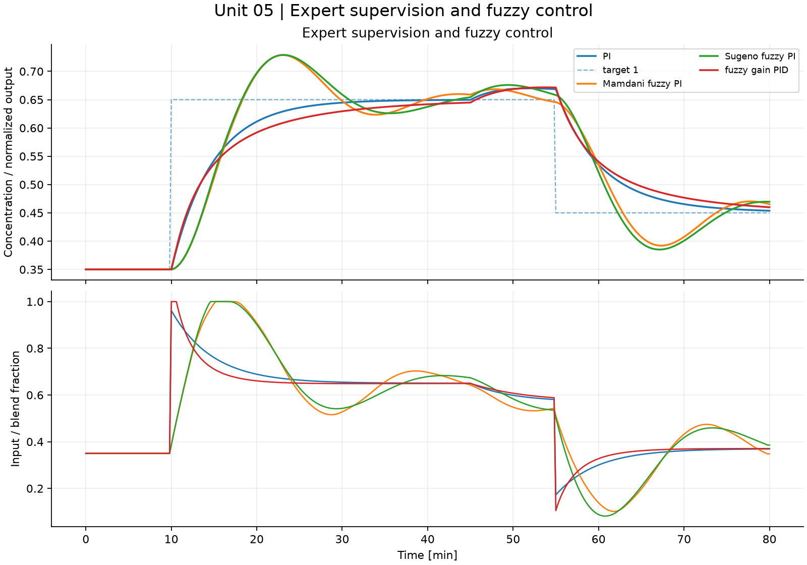

# Intelligent Systems for Process Control and Automation

### From physical balances to constrained and intelligent control

[](https://github.com/fobos123deimos/Undergraduate-Course-Intelligent-Systems-for-Process-Control-and-Automation/actions/workflows/validate.yml)


An English study collection with nine computational laboratories, connected derivations, 45 integrated problems and worked solutions. Eight units follow the supplied syllabus; a ninth extends the laboratories with Markov chains and hidden Markov models for process diagnosis. A separate benchmark track covers every section of Kroll and Schulte's 2014 survey, with a model-by-model account of equations, data requirements and reproduction limits. All newly simulated course data are synthetic.

Course context: **Sistemas Inteligentes em Controle e Automação de Processos**, associated by the repository owner with **Prof. Michela Mulas**. [Official UFC faculty profile](https://ppgeti.ufc.br/pt/michela-mulas/). These new materials are an independent study collection, not an official syllabus, nor materials reviewed or endorsed by the professor.

## Start here

- [Course guide, prerequisites and complete syllabus mapping](course/README.md)
- [Integrated problems and worked solutions](problem-sets/README.md)
- [All article benchmarks: models, protocols and evidence boundaries](benchmarks/README.md)
- [Corrected physical Blending Tank: independent equations, linearization and fresh Simulink generator](blending-tank/README.md)
- [Original Blending Tank archive and mathematical review](legacy/blending-tank/README.md)
- [References and English/Portuguese video lessons](docs/REFERENCES.md)
- [Execution evidence](docs/VALIDATION.md) and [limitations](docs/LIMITATIONS.md)

## Nine connected laboratories

| Unit | Focus | Notebook | Computed results |
|---|---|---|---|
| 01 | [Modeling, identification and simulation](laboratories/01-modeling-identification/README.md) | [Colab](https://colab.research.google.com/github/fobos123deimos/Undergraduate-Course-Intelligent-Systems-for-Process-Control-and-Automation/blob/main/laboratories/01-modeling-identification/notebook.ipynb) | [Metrics](laboratories/01-modeling-identification/results/metrics.json) |
| 02 | [Feedback, stability and IMC](laboratories/02-feedback-imc/README.md) | [Colab](https://colab.research.google.com/github/fobos123deimos/Undergraduate-Course-Intelligent-Systems-for-Process-Control-and-Automation/blob/main/laboratories/02-feedback-imc/notebook.ipynb) | [Metrics](laboratories/02-feedback-imc/results/metrics.json) |
| 03 | [Multiloop, feedforward and cascade](laboratories/03-control-structures/README.md) | [Colab](https://colab.research.google.com/github/fobos123deimos/Undergraduate-Course-Intelligent-Systems-for-Process-Control-and-Automation/blob/main/laboratories/03-control-structures/notebook.ipynb) | [Metrics](laboratories/03-control-structures/results/metrics.json) |
| 04 | [Constrained SISO and MIMO MPC](laboratories/04-model-predictive-control/README.md) | [Colab](https://colab.research.google.com/github/fobos123deimos/Undergraduate-Course-Intelligent-Systems-for-Process-Control-and-Automation/blob/main/laboratories/04-model-predictive-control/notebook.ipynb) | [Metrics](laboratories/04-model-predictive-control/results/metrics.json) |
| 05 | [Expert rules, fuzzy PI and fuzzy PID](laboratories/05-expert-fuzzy-control/README.md) | [Colab](https://colab.research.google.com/github/fobos123deimos/Undergraduate-Course-Intelligent-Systems-for-Process-Control-and-Automation/blob/main/laboratories/05-expert-fuzzy-control/notebook.ipynb) | [Metrics](laboratories/05-expert-fuzzy-control/results/metrics.json) |
| 06 | [Perceptron, MLP, RBF, SOM and neural control](laboratories/06-neural-identification-control/README.md) | [Colab](https://colab.research.google.com/github/fobos123deimos/Undergraduate-Course-Intelligent-Systems-for-Process-Control-and-Automation/blob/main/laboratories/06-neural-identification-control/notebook.ipynb) | [Metrics](laboratories/06-neural-identification-control/results/metrics.json) |
| 07 | [Binary/real genetic algorithms and MPC tuning](laboratories/07-evolutionary-tuning/README.md) | [Colab](https://colab.research.google.com/github/fobos123deimos/Undergraduate-Course-Intelligent-Systems-for-Process-Control-and-Automation/blob/main/laboratories/07-evolutionary-tuning/notebook.ipynb) | [Metrics](laboratories/07-evolutionary-tuning/results/metrics.json) |
| 08 | [Integration, uncertainty and fair comparison](laboratories/08-integrated-validation/README.md) | [Colab](https://colab.research.google.com/github/fobos123deimos/Undergraduate-Course-Intelligent-Systems-for-Process-Control-and-Automation/blob/main/laboratories/08-integrated-validation/notebook.ipynb) | [Metrics](laboratories/08-integrated-validation/results/metrics.json) |
| 09 | [Markov chains, HMM diagnosis and causal supervision](laboratories/09-markov-hidden-state-diagnosis/README.md) | [Colab](https://colab.research.google.com/github/fobos123deimos/Undergraduate-Course-Intelligent-Systems-for-Process-Control-and-Automation/blob/main/laboratories/09-markov-hidden-state-diagnosis/notebook.ipynb) | [Metrics](laboratories/09-markov-hidden-state-diagnosis/results/metrics.json) |



The common example uses a hypothetical 100 L mixture with 10 L/min total flow. Its 10 min residence time makes the roles of modeling, sampling, constraints and controller tuning visible. This parameter set is separate from the preserved historical Blending Tank files. Model equations, assumptions and controller information are stated before each comparison.

## Reproduce the work

```bash
python -m pip install -r requirements.txt
python tools/run_course.py --all
python tools/validate.py --notebooks
```

An individual laboratory runs with `python tools/run_course.py --unit 4`. Results include trace CSV files, numerical metrics, SVG and PNG figures. Unit 7 runs nested optimization and takes longer. The notebooks execute the same inspectable functions as the command-line experiments.

For MATLAB or GNU Octave:

```matlab
addpath('matlab');
run_lesson(4);
validate_all;
```

See the [MATLAB/Octave guide](matlab/README.md) for numerical differences and the [Simulink guide](simulink/README.md) for model generation and required products. A source generator does not by itself certify that a proprietary runtime was executed; consult the validation record.

## Article benchmark track

The survey includes two artificial recurrence systems; identification data repositories; an inverted pendulum; an electromechanical throttle; pneumatic and hydrostatic actuators; three tanks; biochemical and chemical reactors; a binary distillation column; the ALSTOM gasifier; wind turbines; and Tennessee Eastman. Some entries specify differential equations, others depend on measured records or external plant code. The [benchmark inventory](benchmarks/README.md) distinguishes those cases explicitly and provides executable models or source interfaces as appropriate.

Reference: A. Kroll and H. Schulte, *Benchmark problems for nonlinear system identification and control using Soft Computing methods: Need and overview*, Applied Soft Computing 25 (2014), 496–513. [DOI](https://doi.org/10.1016/j.asoc.2014.08.034).

## Organization

```text
course/                 eight core lessons, one enrichment, notes and bibliography
laboratories/           nine executable notebooks with results
problem-sets/           integrated questions and worked reasoning
python/intelligent_control/  inspectable methods, experiments and benchmarks
matlab/                 MATLAB/Octave implementations
simulink/               model-building scripts
benchmarks/             paper inventory, protocols and external-source interfaces
blending-tank/          corrected independent physical tank, notebook and evidence
legacy/blending-tank/   preserved user code and review
docs/                   references, scope and validation evidence
tools/                  experiment, notebook and validation commands
```

The repository follows the organization of [Control of Dynamical Systems](https://github.com/fobos123deimos/Undergraduate-Course-Control-of-Dynamical-Systems). New teaching explanations, problems and figures are written for this collection; received course PDFs and the journal PDF are not redistributed. Scientific models and third-party source data retain their attribution. See [authorship and source handling](docs/AUTHORSHIP.md).
