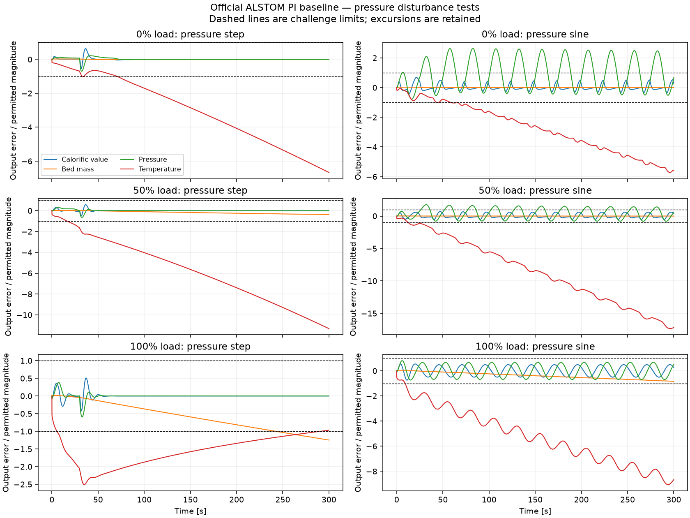
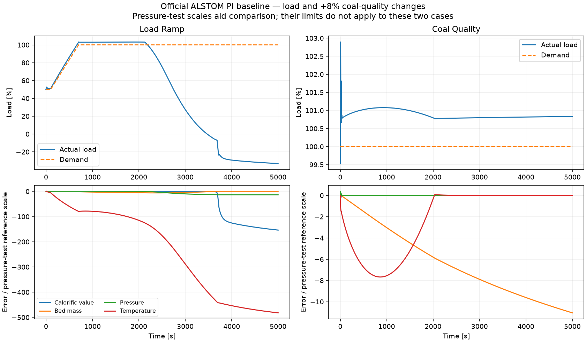
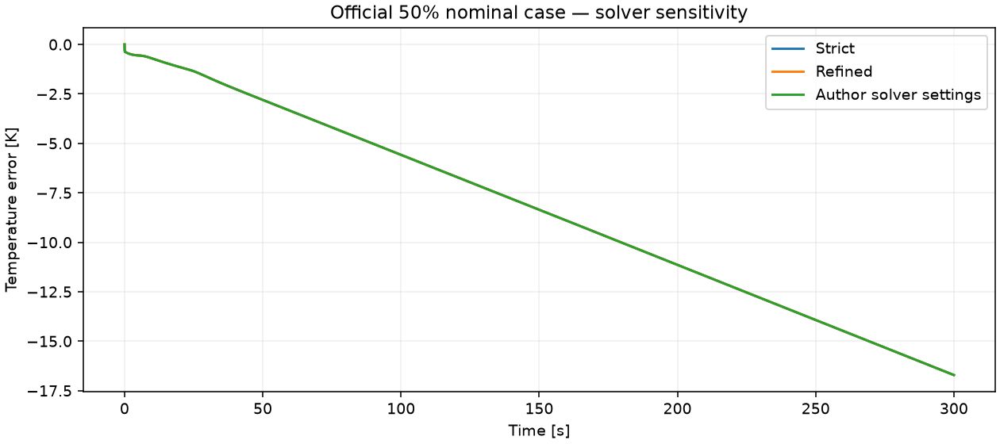

# Native ALSTOM Gasifier II results

On 4 November 2026, [Windows run 41896750740](https://github.com/fobos123deimos/Undergraduate-Course-Intelligent-Systems-for-Process-Control-and-Automation/actions/runs/41896750740) completed the actual author-supplied R2017 nonlinear plant and PI controller in MATLAB R2025b Update 7 with Simulink. Source commit: `cb19bdb5bf36df5007cd8b4c249863d8bd2380db`. This is native execution of the 25 plant states and three controller states, not a reduced surrogate.

## Evidence and scope

- [Native report](results/alstom-native/validation.json): eleven challenge cases and two additional nominal solver checks.
- [Independent analysis](results/alstom-native/analysis.json): thirteen CSV files, 62186 rows; source-result hashes, finite values, time alignment, disturbance/load definitions, command/plant-input identities and all reported maximum/IAE/input metrics recomputed in Python.
- [Provenance](results/alstom-native/provenance.json): source, runtime, workflow, artifact checksum and private-input cleanup record.
- [Source manifest](alstom_manifest.json) and [external guide](EXTERNAL_MODELS.md): package version, source-file hashes, challenge definitions and runtime requirements.

Three nominal and six pressure-disturbance cases run for 300 s at 0%, 50% and 100% load. The pressure step is -20000 Pa from 30 s; the sine has amplitude 20000 Pa and frequency 0.04 Hz. A 50% to 100% demand ramp runs over 100–700 s and is followed to 5000 s. The +8% coal-quality ramp runs over 10–20 s from 100% load and is followed to 5000 s. This does not cover the complete ±18% coal-quality envelope or alternative controllers.

The default wrapper uses ode23tb, relative tolerance 1e-6, absolute tolerance 1e-8 and maximum step 0.25 s. The author plant, PI gains, initial-state files and demand interpolation remain unchanged. CSVs retain both the official `ut` controller commands **before** actuator constraints and the actual five mass flows **after** those constraints. The four independent applied inputs satisfy magnitude/rate bounds within numerical tolerance; residual slew violations are at floating-point scale (about 8e-8 kg/s²). Command violations are reported separately. Limestone is a fifth flow linked to coal, not an independent manipulated variable.

## PI performance: limits are not all satisfied

The table reports maximum absolute output error divided by the pressure-test tolerance. Values greater than one violate that tolerance. Tolerances are 10000 J/kg for calorific value, 500 kg for bed mass, 10000 Pa for pressure and 1 K for temperature.

| Case | Calorific value | Bed mass | Pressure | Temperature |
|---|---:|---:|---:|---:|
| load000-pressure_step | 0.640 | 0.022 | 0.699 | 6.667 |
| load000-pressure_sine | 0.689 | 0.029 | 2.635 | 5.721 |
| load050-pressure_step | 0.580 | 0.374 | 0.647 | 11.315 |
| load050-pressure_sine | 0.710 | 0.022 | 1.760 | 17.352 |
| load100-pressure_step | 0.510 | 1.248 | 0.596 | 2.509 |
| load100-pressure_sine | 0.744 | 0.841 | 0.808 | 9.061 |

All six pressure cases exceed the temperature tolerance. The sine cases at 0% and 50% exceed pressure tolerance; the 100% step also exceeds the bed-mass tolerance. Successful execution and verified inputs therefore do not mean the PI meets the challenge requirements.



The long load ramp also loses tracking and leaves the stated 0–100% normalized operating-load range. A negative normalized-load percentage is **not negative physical power**. Coal-quality changes produce substantial temperature and bed-mass excursions. The pressure-test tolerance scales in the following plot are used only for visual comparison: their acceptance limits do not apply to these two experiments. These long cases have not yet received an independent solver-refinement study.



## Nominal drift and solver sensitivity

At 50% nominal load the final temperature error is approximately -16.7123 K despite initially matching the demand. Two extra 300 s executions retain the same plant, controller and initialization:

| Configuration | Relative / absolute tolerance | Maximum step | Maximum output change from strict run, scaled by pressure tolerances |
|---|---|---:|---:|
| Refined | 1e-7 / 1e-9 | 0.125 s | 0.000114454 |
| Author diagram settings | 1e-3 / 1e-6 | 2 s | 0.0136859 |

All three use ode23tb. Comparison uses linear interpolation on the 0:1:300 s grid. The largest refined temperature difference is 2.39e-5 K; the author-settings final temperature error is -16.71243 K. The observed nominal drift persists across these settings, so changing the tested step/tolerances does not remove it. This is a local sensitivity check, not proof of correctness of the binary under every runtime or convergence of the long ramp/coal experiments. Historical reference trajectories or an authoritative compatible environment remain necessary to reconcile this behavior with the original study.



## Reproduce and source handling

```matlab
addpath('benchmarks');
validate_alstom_reference('path/to/Gasifier_R2017','new-result-directory');
```

The command requires Windows x64 MATLAB/Simulink, the verified author package and the Microsoft VC2010 runtime. The [Windows workflow](../.github/workflows/alstom-windows.yml) records the tested setup and pinned runtime installer. Direct automatic source download still returns HTTP 403; rerunning after cleanup requires the package holder to supply private inputs again or use a compatible local installation.

The completed execution used seventeen encrypted temporary repository inputs. All seventeen were deleted, and a separate authenticated read confirmed absence for every entry. The public repository contains only derived traces, reports and figures. The author archive, MEX binary, original diagrams and specification are not redistributed.

Recheck the preserved results without MATLAB:

```bash
python benchmarks/analyze_alstom_results.py
```

This command verifies and plots completed results; it does not execute the external simulator.
