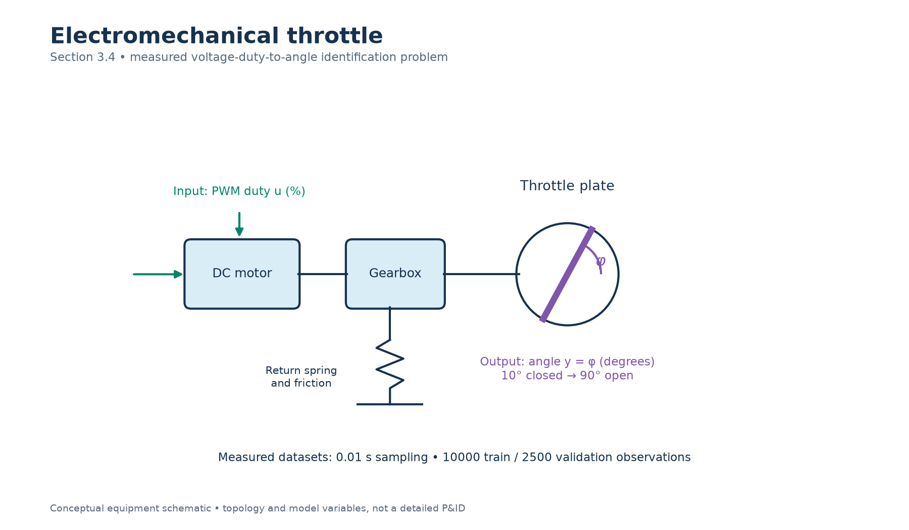
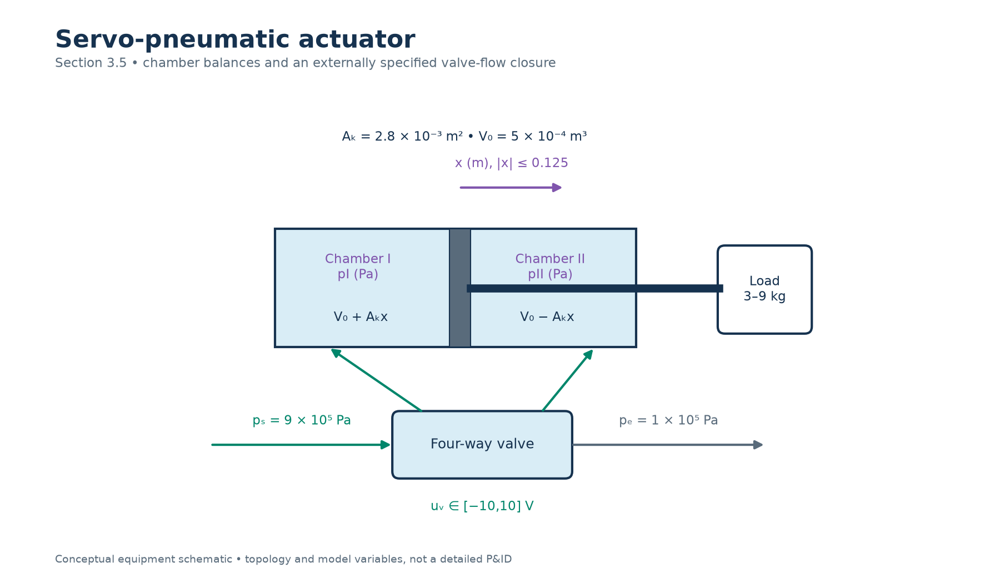
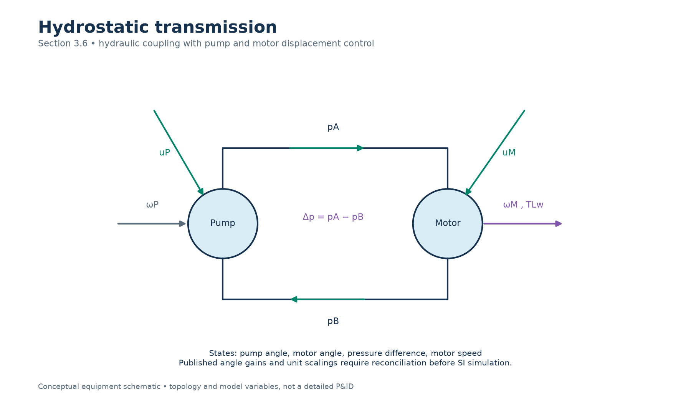
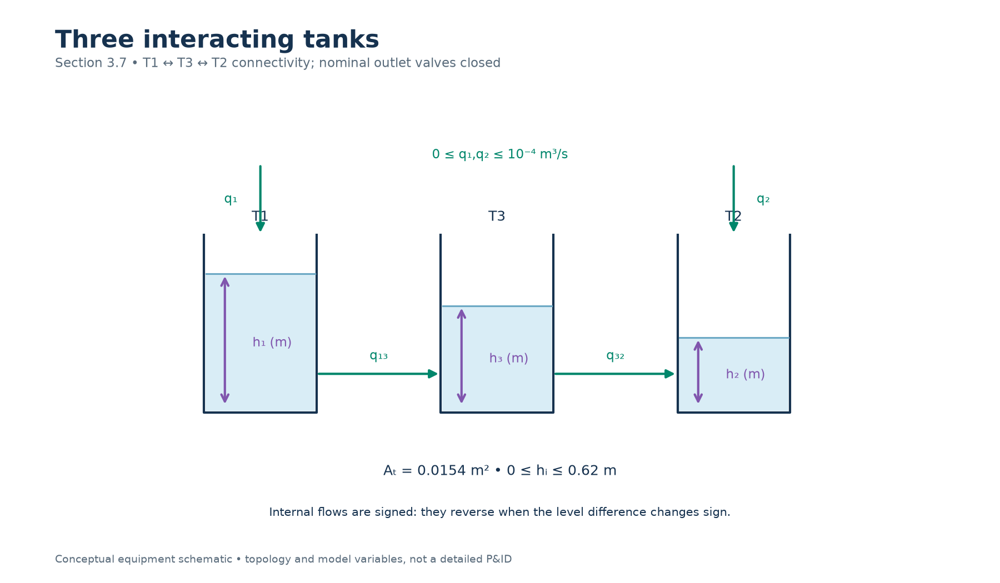
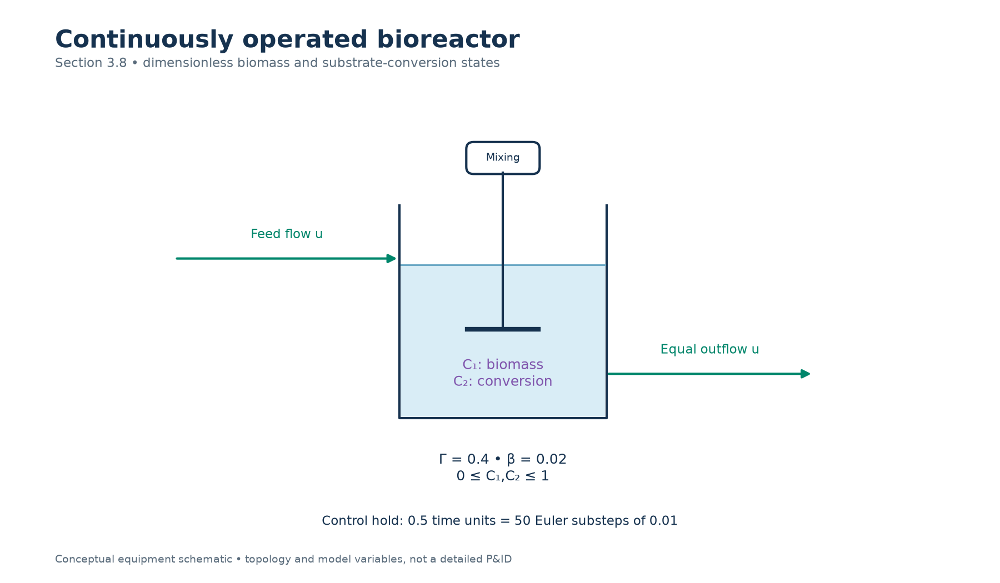
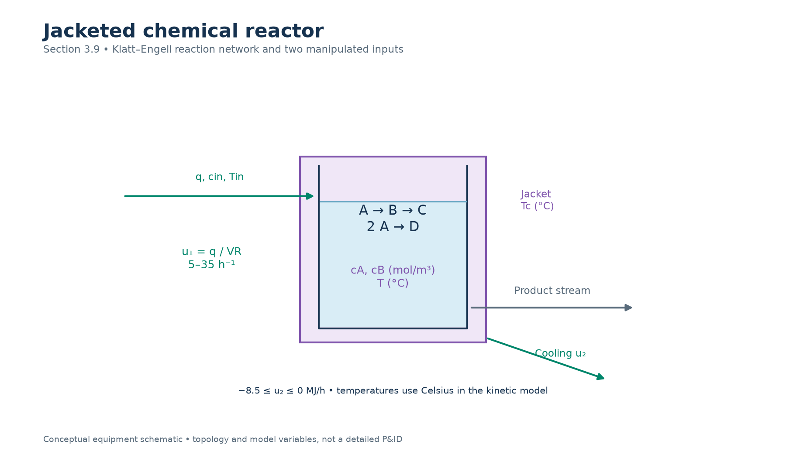
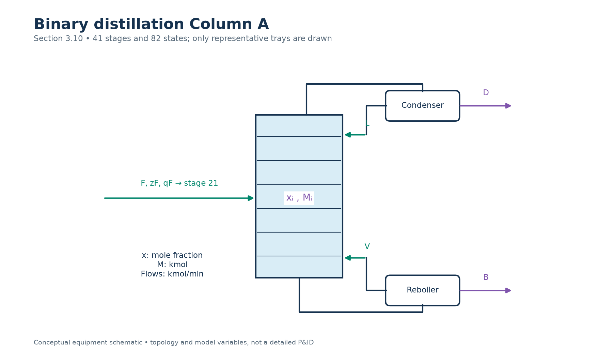
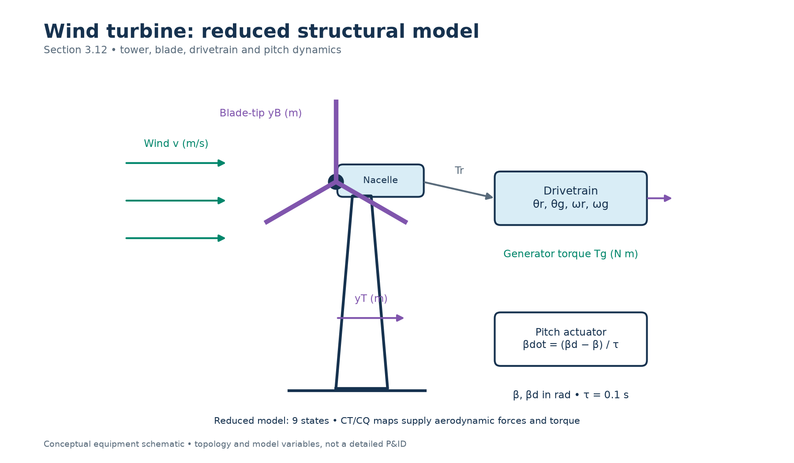
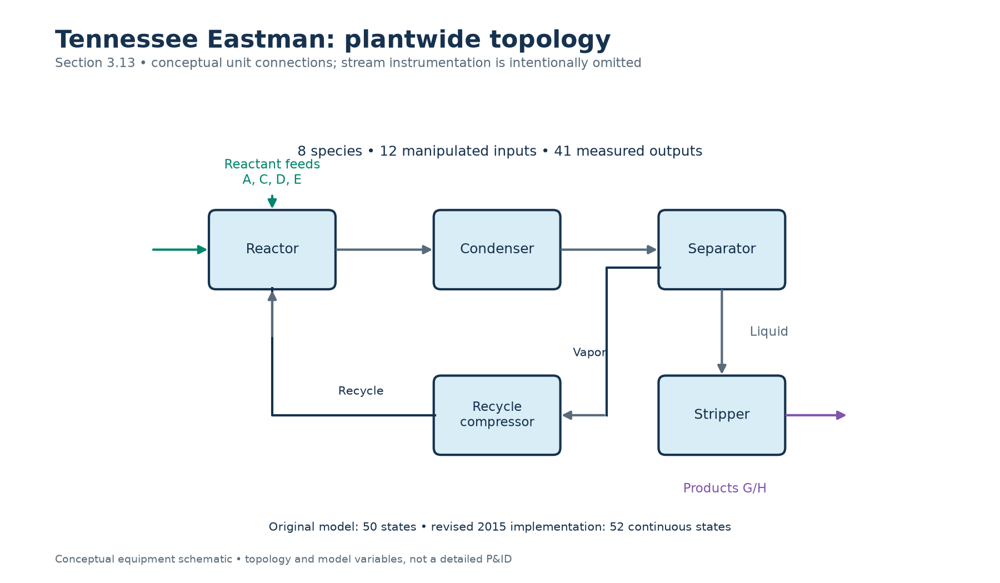

# Equipment and model-variable gallery

Eleven original conceptual schematics connect the paper's benchmark equipment to the variables used by the programs. Green arrows denote manipulated inputs or material-flow directions; purple labels emphasize modeled/measured outputs and states; gray arrows show other mechanical or process connections. Each figure also labels its signals explicitly, so color is not required to interpret it. These are explanatory diagrams, not detailed engineering P&IDs, construction drawings or copied article figures.

The [case studies](CASE_STUDIES.md) use the same state/input conventions. The [benchmark inventory](README.md) documents which models are fully executable, which introduce declared assumptions, and which require external data or simulators. An equipment drawing does not remove those reproduction limits.

Regenerate editable SVG and high-resolution PNG files with:

```bash
python benchmarks/draw_schematics.py
```

## Cart and inverted pendulum

Upright θ=0, cart position x, pendulum length/mass, and saturated external force. The diagram identifies coordinates rather than prescribing a feedback law. [Editable SVG](figures/03-pendulum.svg).


## Electromechanical throttle

Motor, gearbox, restoring spring and plate-angle measurement. Physical parameter uncertainty is precisely why the measured identification dataset matters. [Editable SVG](figures/04-throttle.svg).



## Servo-pneumatic actuator

Chamber volumes and pressure-force direction are shown in an unfolded horizontal x-coordinate. The original benchmark describes a vertical payload; its printed balance omits gravity, as discussed in the source audit. The schematic does not supply the missing valve flow law. [Editable SVG](figures/05-pneumatic.svg).



## Hydrostatic transmission

Pump and motor connect through a closed hydraulic circuit; displacement commands change pressure and speed together. The published numerical scaling remains qualified in the code. [Editable SVG](figures/06-hydrostatic.svg).



## Three-tank system

The physical order is T1–T3–T2. Internal flows are signed, and all nominal drains are closed. The arrows illustrate the displayed level ordering; reversing a level difference reverses its flow. [Editable SVG](figures/07-three-tanks.svg).



## Biochemical reactor

Biomass and conversion are dimensionless states. Equal inflow/outflow and a fixed controller hold connect the process view to the sampled model. [Editable SVG](figures/08-bioreactor.svg).



## Klatt–Engell chemical reactor

The desired reaction and its undesired parallel/consecutive paths share a jacketed vessel. Feed dilution and cooling energy are distinct manipulated inputs. Celsius and cooling units match the implemented energy balances. [Editable SVG](figures/09-cstr.svg).



## Distillation Column A

Representative trays indicate a 41-stage model including the total condenser and reboiler. The feed enters stage 21; reflux/boilup and distillate/bottoms flows have separate roles. Two states per stage produce 82 states. [Editable SVG](figures/10-column-a.svg).



## ALSTOM gasifier

The figure shows the control interface rather than inventing internal plant equipment. Limestone follows coal at a fixed ratio; the official package determines numerical limits and exact disturbance tests. [Editable SVG](figures/11-gasifier.svg).


## Wind turbine

Tower/blade deflections, drivetrain rotation and pitch form the reduced nine-state model. The full aeroelastic verification problem requires FAST/OpenFAST and a complete reference case. [Editable SVG](figures/12-wind-turbine.svg).



## Tennessee Eastman

The five major process units and the recycle path explain the plantwide character of the benchmark. Detailed feed locations, purge, utility circuits, measurement lags and controller instrumentation remain in the official model. [Editable SVG](figures/13-tennessee-eastman.svg).


