# Benchmark atlas: original names and detailed TikZ drawings

Fourteen original vector plates cover the thirteen benchmark sections of Kroll and Schulte (2014). Every plate carries the original section title; the table maps it to the names used in this repository. Section 3.2 is a collection of data resources, and section 3.1 contains two artificial examples.

[Download the complete vector PDF](figures/tikz/benchmark-atlas.pdf) · [Editable TikZ sources](tikz/) · [Build and verification record](figures/tikz/build.json)

These explanatory reconstructions connect physical equipment, signals and model variants. They are not construction P&IDs. The [source audit](README.md) and [case studies](CASE_STUDIES.md) retain data-access, calibration and simulator limitations; more visual detail does not establish new numerical validation.

| Paper section | Original title in the article | Repository names |
|---|---|---|
| 3.1 | Artificial system identification problems | `artificial_siso`, `artificial_mimo` |
| 3.2 | Data repositories for system identification and regression | `datasets` |
| 3.3 | Cart with inverted pendulum | `pendulum` |
| 3.4 | Electro-mechanical throttle | `throttle` |
| 3.5 | Servo-pneumatic actuator | `pneumatic`, `pneumatic_physical` |
| 3.6 | Hydrostatic transmission in mobile working machines | `hydrostatic`, `hydrostatic_si` |
| 3.7 | Three-tank-system | `three_tank` |
| 3.8 | Continuously operated bio-chemical reactor | `bioreactor` |
| 3.9 | Continuously stirred chemical reactor | `cstr`, `Klatt-Engell CSTR` |
| 3.10 | Continuously operated binary distillation column | `column_a`, `Column A`, `LV variant` |
| 3.11 | ALSTOM Gasifier Control Benchmark II | `gasifier`, `ALSTOM` |
| 3.12 | Wind turbine | `wind_reduced`, `wind_fast`, `NREL 5-MW`, `OpenFAST` |
| 3.13 | Tennessee Eastman process control problem | `tennessee_eastman`, `TE`, `TEP` |

## 3.1 — Artificial system identification problems

Exact SISO and two-output recurrences, delay memory, excitation and independent evaluation. This family contains two implemented examples, not a physical vessel.

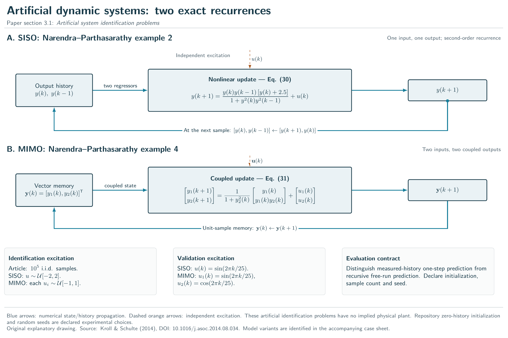

[Vector PDF](figures/tikz/01-artificial.pdf) · [High-resolution PNG](figures/tikz/01-artificial.png) · [TikZ source](tikz/01-artificial.tex)

## 3.2 — Data repositories for system identification and regression

The seven data resources named in the survey and the provenance, split and import contract. This is a resource category, not a plant model.

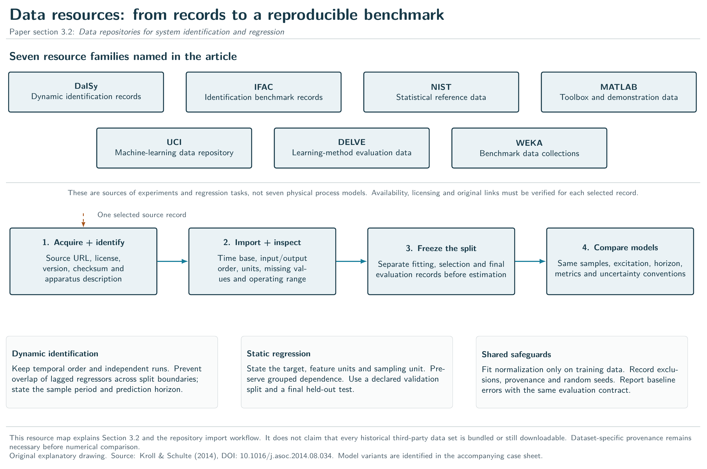

[Vector PDF](figures/tikz/02-datasets.pdf) · [High-resolution PNG](figures/tikz/02-datasets.png) · [TikZ source](tikz/02-datasets.tex)

## 3.3 — Cart with inverted pendulum

Cart, applied force, angular convention, sensors, mechanical coupling and the four-state implementation.

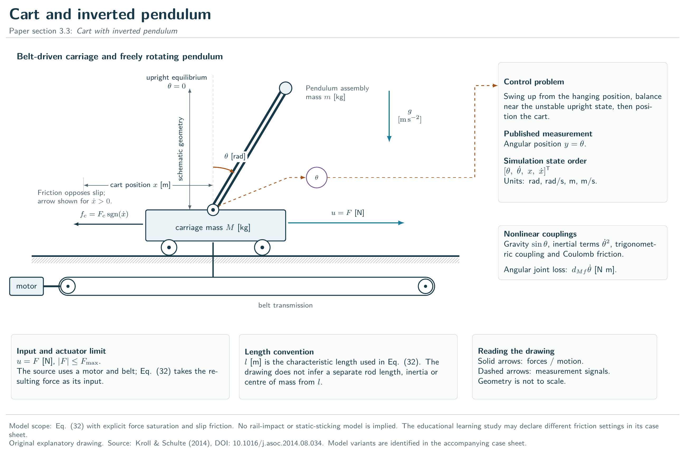

[Vector PDF](figures/tikz/03-pendulum.pdf) · [High-resolution PNG](figures/tikz/03-pendulum.png) · [TikZ source](tikz/03-pendulum.tex)

## 3.4 — Electro-mechanical throttle

Duty-cycle command, motor, transmission, spring, throttle plate and angle measurement. Original measured training/test records remain unavailable; a physical diagram does not replace them.

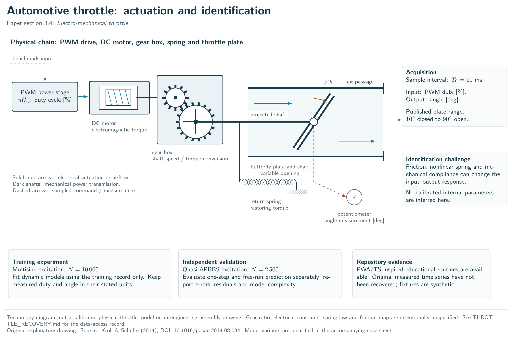

[Vector PDF](figures/tikz/04-throttle.pdf) · [High-resolution PNG](figures/tikz/04-throttle.png) · [TikZ source](tikz/04-throttle.tex)

## 3.5 — Servo-pneumatic actuator

Vertical actuator, payload gravity, chambers, valve paths, gas mass/energy states and derived pressures. The literal survey transcription and the separate physical interpretation remain distinct.


[Vector PDF](figures/tikz/05-pneumatic.pdf) · [High-resolution PNG](figures/tikz/05-pneumatic.png) · [TikZ source](tikz/05-pneumatic.tex)

## 3.6 — Hydrostatic transmission in mobile working machines

Pump/motor, closed hydraulic loop, displacement commands, pressure storage, losses and mechanical load. The SI interpretation states its units and assumptions; historical calibration is still unresolved.


[Vector PDF](figures/tikz/06-hydrostatic.pdf) · [High-resolution PNG](figures/tikz/06-hydrostatic.png) · [TikZ source](tikz/06-hydrostatic.tex)

## 3.7 — Three-tank-system

The physical T1-T3-T2 order, signed inter-tank flows, nominal closed drains, pumps and level measurements.


[Vector PDF](figures/tikz/07-three-tanks.pdf) · [High-resolution PNG](figures/tikz/07-three-tanks.png) · [TikZ source](tikz/07-three-tanks.tex)

## 3.8 — Continuously operated bio-chemical reactor

Mixing, dilution, equal feed/outlet flows, growth/conversion states and sampled command path.

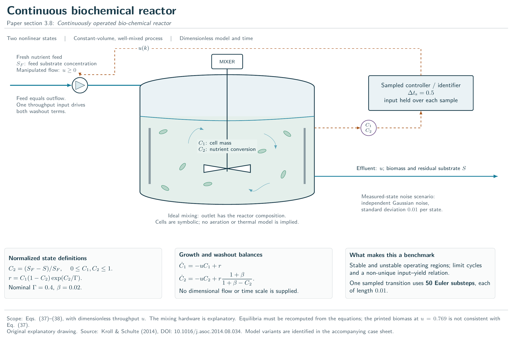

[Vector PDF](figures/tikz/08-bioreactor.pdf) · [High-resolution PNG](figures/tikz/08-bioreactor.png) · [TikZ source](tikz/08-bioreactor.tex)

## 3.9 — Continuously stirred chemical reactor

Jacketed vessel, desired and undesired reaction paths, concentration/temperature states and separate dilution/cooling inputs, retaining the audited Celsius convention.

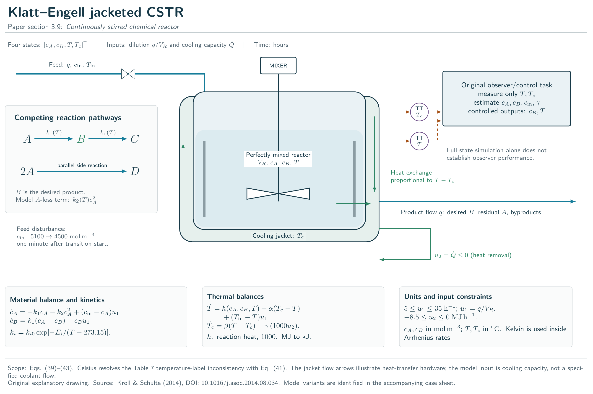

[Vector PDF](figures/tikz/09-cstr.pdf) · [High-resolution PNG](figures/tikz/09-cstr.png) · [TikZ source](tikz/09-cstr.tex)

## 3.10 — Continuously operated binary distillation column

41 stages and 82 states, feed at stage 21, condenser/reboiler, reflux/boilup, products and inventory loops. The 4-input plant and 2-input LV interpretation are explicitly distinguished.

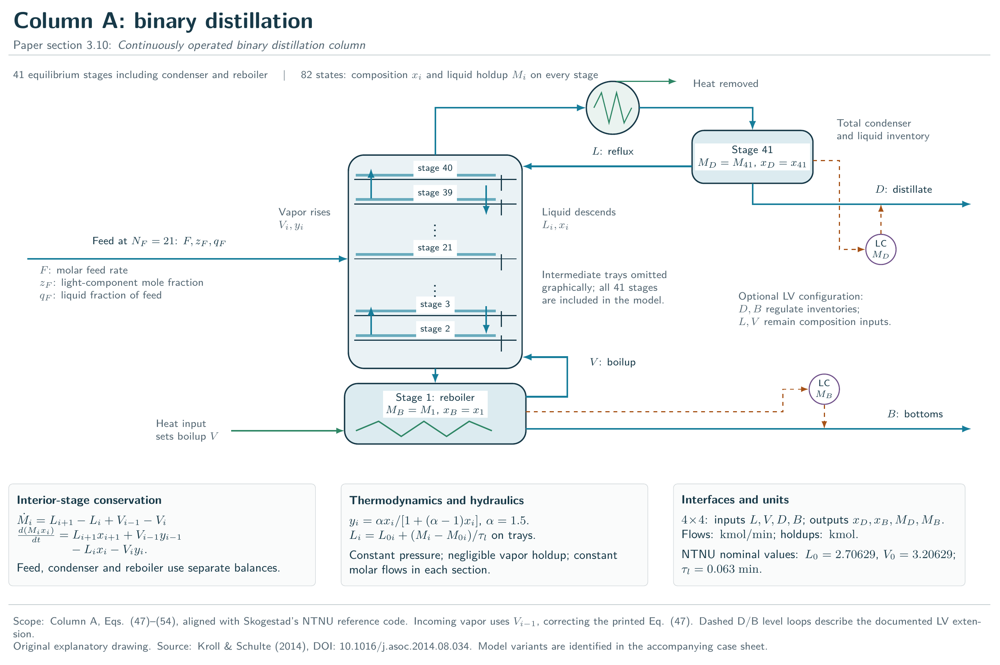

[Vector PDF](figures/tikz/10-column-a.pdf) · [High-resolution PNG](figures/tikz/10-column-a.png) · [TikZ source](tikz/10-column-a.tex)

## 3.11 — ALSTOM Gasifier Control Benchmark II

The five commanded mass flows, four outputs, two disturbances and fixed limestone/coal ratio. A qualitative vessel supports the documented control interface, without inventing proprietary internal hardware.

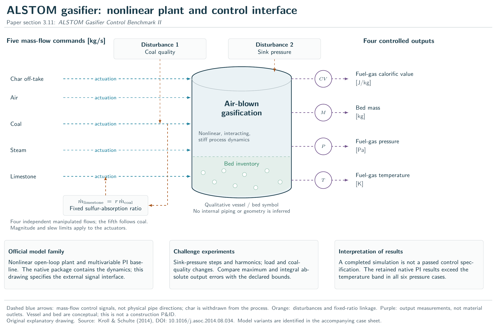

[Vector PDF](figures/tikz/11-gasifier.pdf) · [High-resolution PNG](figures/tikz/11-gasifier.png) · [TikZ source](tikz/11-gasifier.tex)

## 3.12 — Wind turbine

Rotor, blades, tower, drivetrain, generator, pitch actuator and nine reduced states. The reduced model, later ROSCO aerodynamic map and full aeroelastic simulator remain identified as different variants.

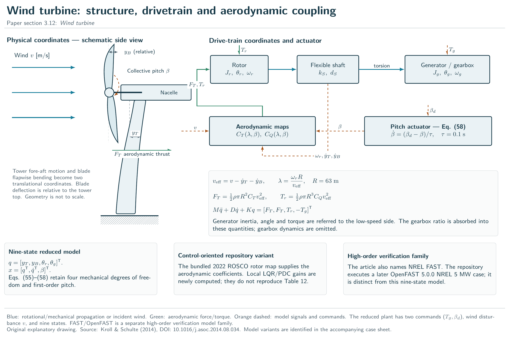

[Vector PDF](figures/tikz/12-wind-turbine.pdf) · [High-resolution PNG](figures/tikz/12-wind-turbine.png) · [TikZ source](tikz/12-wind-turbine.tex)

## 3.13 — Tennessee Eastman process control problem

Five process units, 11 numbered process streams, compressor bypass, purge, cooling and steam utilities, valves and measurement groups. The companion sheet maps all 12 manipulated variables and 41 standard measurements. The archived native C implementation defines 50 states; its inconsistent 52-state introductory comment is documented in the state-count audit.

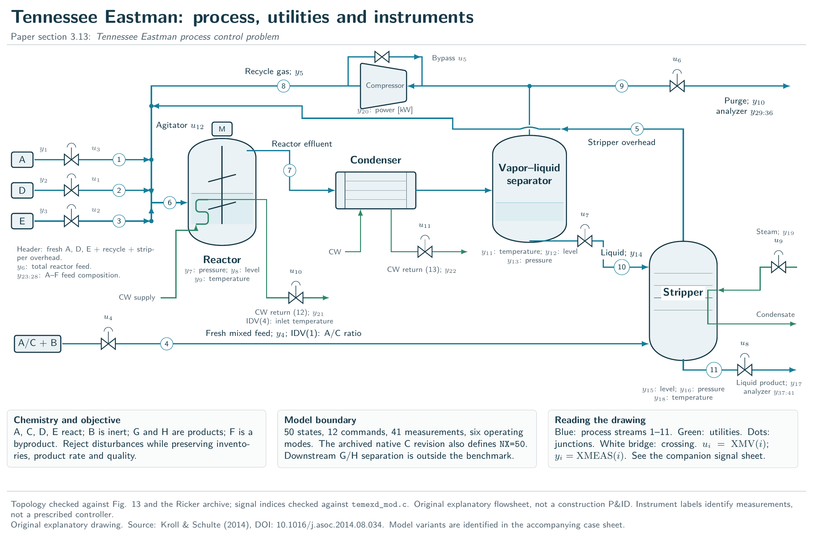

[Vector PDF](figures/tikz/13-tennessee-eastman.pdf) · [High-resolution PNG](figures/tikz/13-tennessee-eastman.png) · [TikZ source](tikz/13-tennessee-eastman.tex)

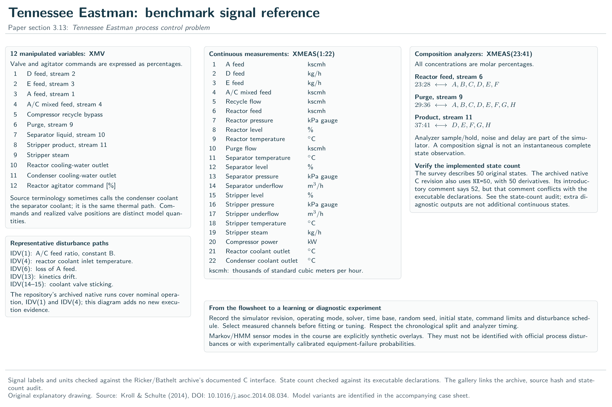

[Signal-reference PDF](figures/tikz/13b-tennessee-eastman-signals.pdf) · [TikZ source](tikz/13b-tennessee-eastman-signals.tex)

## Sources and reproducibility

Kroll, A. and Schulte, H. (2014), *Benchmark problems for nonlinear system identification and control using Soft Computing methods: Need and overview*, Applied Soft Computing 25, 496–513. [DOI](https://doi.org/10.1016/j.asoc.2014.08.034). Original headings follow sections 3.1–3.13. The Tennessee Eastman topology was checked against Fig. 13, and its signal names and units against the documented interface in the [Ricker archive](https://depts.washington.edu/control/LARRY/TE/download.html).

The pneumatic, hydrostatic, reactor, column and wind drawings also follow the explicit implementation audits linked from the benchmark inventory. The [Tennessee Eastman state-count audit](TE_STATE_COUNT_AUDIT.md) explains the correction from a misleading source comment to the executable `NX=50` declaration. The earlier compact diagrams remain available under `figures/`; current case sheets and the API use the detailed `figures/tikz/` plates.

Install Tectonic 0.17.0 and Poppler, then `python -m pip install pypdf`. Run:

```bash
python tools/build_benchmark_atlas.py
python tools/build_benchmark_atlas.py --check
python tools/build_api_docs.py
```

Use `--tectonic /path/to/tectonic --pdftoppm /path/to/pdftoppm` when the executables are not on PATH. `--only-cached` disables TeX bundle downloads after the first build. `--assemble-only` packages and checks already compiled/rendered plates; it does not compile changed sources. The committed build record hashes the sources and all artifacts. Inspect every rendered plate after changing a drawing.
