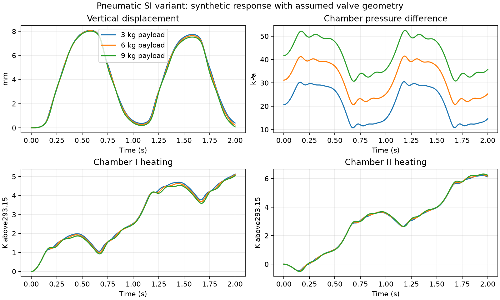

# Pneumatic actuator: primary-source audit and separate SI variant

The literal survey equations remain unchanged in `benchmarks.pneumatic_rhs` and `paper_models('pneumatic',...)`. The new `pneumatic_physical` implementation supplies a complete, explicitly parameterized **teaching variant**, with mass and energy conservation, compressible valve flow and vertical gravity. It is not an identified replacement for the original apparatus.

## What the primary reference resolves

The supplied Kroll-Schulte paper, Section 3.5, Eqs. (33)-(34) and Table 4 (printed pages 501-502), cites **[81] Schulte and Hahn (2004)**. The publisher metadata confirms *Control Engineering Practice* 12(5), 639-650, [DOI 10.1016/S0967-0661(03)00148-5](https://doi.org/10.1016/S0967-0661(03)00148-5). The accessible [author-uploaded manuscript](https://www.researchgate.net/publication/200150241_Fuzzy_state_feedback_gain_scheduling_control_of_servo-pneumatic_actuators) provides these distinctions:

- Eq. (12) uses `xv = kv uv` and locally identified pressure coefficients.
- Eq. (13) deliberately excludes weight. Eq. (22) removes `M g/A` and the Coulomb offset from measured differential pressure before fitting. Thus the local model uses offsets; physical vertical pressure still supports weight.
- Eq. (19) gives estimated viscous and Coulomb coefficients 135 N s/m and 21 N.
- Section 2.3 explains why local pressure coefficients are identified instead of uncertain physical valve parameters.

The three reported local fits in Table 3 are available through `identified_local_model(index)` in Python and `pneumatic_physical('local',index)` in MATLAB:

| Index | Payload kg | Position m | QL s^-1 | Qdx Pa/m | Qxv Pa/(s m) |
|---|---:|---:|---:|---:|---:|
|1|0|0|-26|-8.7e6|1.1e10|
|3|6|0|-11|-8.9e6|1.0e10|
|15|6|0.08|-14|-1.06e7|1.24e10|

Their states are deviations `[position,velocity,differential pressure]`; the voltage input includes the published `kv = 1e-4 m/V`. They are local fitted models, not a global valve calibration or an independent validation dataset. The publisher [publication record](https://www.sciencedirect.com/science/article/pii/S0967066103001485) resolves inconsistent issue metadata on the author-upload page.

## Units and assumptions

| Item | Evidence and decision |
|---|---|
|Gas constant|Table 4 prints 8.314 N m/(kg K), while flows are kg/s. The value 8.314 is a molar constant in J/(mol K): see [NIST CODATA](https://physics.nist.gov/cuu/pdf/all.pdf). A mass-based state requires `R=Ru/Mair`, as explained by [NASA's equation of state](https://www.grc.nasa.gov/www/k-12/airplane/eqstat.html). This variant uses Ru = 8.31446261815324 J/(mol K), Mair = 0.0289644 kg/mol and R ≈ 287.058 J/(kg K). The molar mass is the standard-air value in [NASA/TP-2006-213486, Table 4](https://ntrs.nasa.gov/api/citations/20060053240/downloads/20060053240.pdf). This resolves the dimensional inconsistency without silently changing the transcription.|
|Thermal closure|The survey lists nominal 293.15 K but does not specify kappa. This variant uses calorically perfect air, gamma=cp/cv=1.4 and cp−cv=R, supported by [NASA's specific-heat relations](https://www1.grc.nasa.gov/beginners-guide-to-aeronautics/specific-heat-cp-cv/). Chamber temperatures evolve. Strictly isothermal closed gas would obey pV=constant, whereas adiabatic closed gas obeys pV^gamma=constant; the tests distinguish these cases.|
|Gravity|Positive displacement is upward. Absolute chamber pressures produce `M dv/dt=A(pI−pII)−friction−Mg−Fexternal`. The source's identified deviation model and this physical absolute-pressure model have different coordinates.|
|Volumes|Retain `VI=V0+Ax` and `VII=V0−Ax`, V0 = 5e-4 m³, A = 2.8e-3 m². At the declared operating limits ±0.125 m, the smaller volume is 1.5e-4 m³. This is an arithmetic consequence, **not a recovered clearance-volume measurement**. The sources do not establish whether it represents dead space, unused travel or both. States outside the operating interval are rejected; there is no hard-stop impact model.|
|Valve geometry|Use `area=width*abs(kv*clip(uv,−10,10))`. The width 2 mm, Cd 0.7, zero deadband and zero default bypass area are new choices. They are not measured characteristics of the source test bed.|
|Friction|Use `135v+21tanh(v/0.005)` N. Coefficients come from the source; the 0.005 m/s smoothing scale is new. This retains dissipative slip friction but does not model static sticking, Stribeck effects or hysteresis.|
|Heat transfer|Default wall conductance is 0 W/K, an adiabatic choice. A nonnegative optional conductance provides `Q=H(Twall−T)`. It has not been calibrated. With heat transfer enabled, the equilibrium initializer uses the wall temperature.|
|Payload|Each simulation has a constant payload. The short study runs 3, 6, and 9 kg separately; it does not claim a 200% time-varying-mass benchmark. Attaching mass during motion would require an additional momentum/energy convention.|

## Conservation-based implementation

State order is `[x,v,mI,mII,TI,TII]`. Each chamber pressure is absolute: `p=mRT/V`. The mass balance sums signed flows. Its stored internal energy satisfies

```text
U = m cv T
dU/dt = sum(mdot_in cp Tin) - sum(mdot_out cp T) + Q - p dV/dt
dT/dt = (dU/dt - cv T dm/dt)/(m cv)
```

Internal bypass transports upstream enthalpy and cancels in the total two-chamber mass/energy budget. Negative port flow reverses both transported mass and upstream temperature. Constant-payload mechanical energy closes the total balance: external enthalpy plus wall heat minus friction and external-force work.

The valve law is derived from the ideal-gas isentropic nozzle relation, with the [NASA sonic mass-flow limit](https://www.grc.nasa.gov/www/k-12/airplane/mflchk.html). For actual upstream pressure/temperature `pu,Tu`, downstream ratio `r=pd/pu`, and `rcrit=(2/(gamma+1))^(gamma/(gamma−1))`:

```text
mdot = Cd area pu/sqrt(R Tu) * Phi(r)
Phi(r) = sqrt(2 gamma/(gamma−1) * (r^(2/gamma)-r^((gamma+1)/gamma)))  if r>rcrit
Phi(r) = sqrt(gamma)*(2/(gamma+1))^((gamma+1)/(2*(gamma−1)))          otherwise
```

This is a reservoir-orifice approximation; it omits spool dynamics, finite-pipe pressure recovery and calibrated low-pressure laminar behavior. It is not an implementation or certification of ISO 6358. [MathWorks' gas-restriction documentation](https://www.mathworks.com/help/simscape/ref/localrestrictiong.html) independently describes reversible flow, enthalpy conservation and choking, but uses a richer finite-area restriction model than this implementation.

## Run and inspect

```bash
python benchmarks/run_pneumatic.py
python -m pytest tests/test_pneumatic_physical.py -q
```

```matlab
addpath('matlab');
report = validate_pneumatic_physical;
p = pneumatic_physical('parameters');
x0 = pneumatic_physical('equilibrium',0,5e5,p);
result = pneumatic_physical('simulate',@(t)2*sin(2*pi*t),x0,p,2,201);
```

With MATLAB and Simulink, `addpath('simulink'); validate_pneumatic_simulink('pneumatic-output')` builds and validates a separate six-state diagram for the three payloads. The output directory must be new. This supplementary validator does not overwrite the preserved survey diagram or the previously validated 25-model gallery. Runtime evidence must be read from its generated `validation.json`; source availability alone is not execution evidence.

The short study applies a 2 V, 1 Hz sinusoid from vertical equilibrium. [Metrics](results/pneumatic_physical_metrics.json), three CSV trajectories and the plot below record synthetic responses. The Python reference fixture is reproducible with `python benchmarks/run_pneumatic.py --write-reference`; MATLAB validates it using a different integrator. The tests check sonic-flow continuity/scaling/reversal, physical domains, gravity equilibrium, bypass cancellation, open-system first-law balance and sealed adiabatic invariants. These establish numerical and internal physical consistency, not agreement with unprovided apparatus measurements.

On 4 November 2026, all 23 Python tests passed. The [Octave 11.3 validation](results/pneumatic_octave_validation.json) passed the full three-payload study: maximum scaled trajectory disagreement with Python was 3.06e-9, the sealed adiabatic relative residual was 1.20e-14, and the first-law residual was 1.72e-14 W. Separate [native edge checks](results/pneumatic_octave_edge_validation.json) confirmed equilibrium at a heated wall and rejection of complex states. Simulink execution is a separate check; these Octave results do not establish it.



## Remaining external requirements

No complete voltage-to-mass-flow calibration was recovered for the actual Schulte-Hahn apparatus. Canonical predictions still require measured valve geometry/discharge or sonic-conductance curves, leakage/deadband and spool dynamics; thermal/clearance-volume identification; friction/stiction data; and the original excitation/response records. The public primary manuscript resolves the gravity-offset interpretation and supplies three local fitted models. It does not turn the newly selected orifice parameters into experimentally identified values. No author contact, authentication bypass or restricted-document redistribution was used.

A specific unresolved lead is Hahn's earlier *Nonlinear Control of a Servopneumatic Actuator*, *at* 48(3), 140-150, [DOI 10.1524/auto.2000.48.3.140](https://doi.org/10.1524/auto.2000.48.3.140), cited by Schulte-Hahn. Its [public record](https://www.researchgate.net/publication/245403731_Nichtlineare_Regelung_eines_servopneumatischen_Antriebs_Nonlinear_Control_of_a_Servopneumatic_Actuator) describes physical modeling and parameter identification, but reports no public full text. The DOI endpoint was unavailable through the retrieval tool on 4 November 2026. Its uninspected contents are not used to assign valve parameters here.

Native MATLAB R2025b Update 7 and Simulink subsequently passed [run 41896147563](https://github.com/fobos123deimos/Undergraduate-Course-Intelligent-Systems-for-Process-Control-and-Automation/actions/runs/41896147563). The [three-payload report](../simulink/models/physical-variants/pneumatic/validation.json) records maximum scaled state error 6.39e-9 and pressure error 1.37e-8 versus independent Python trajectories. The [SLX and diagram](../simulink/models/README.md) are preserved with source/artifact hashes.
