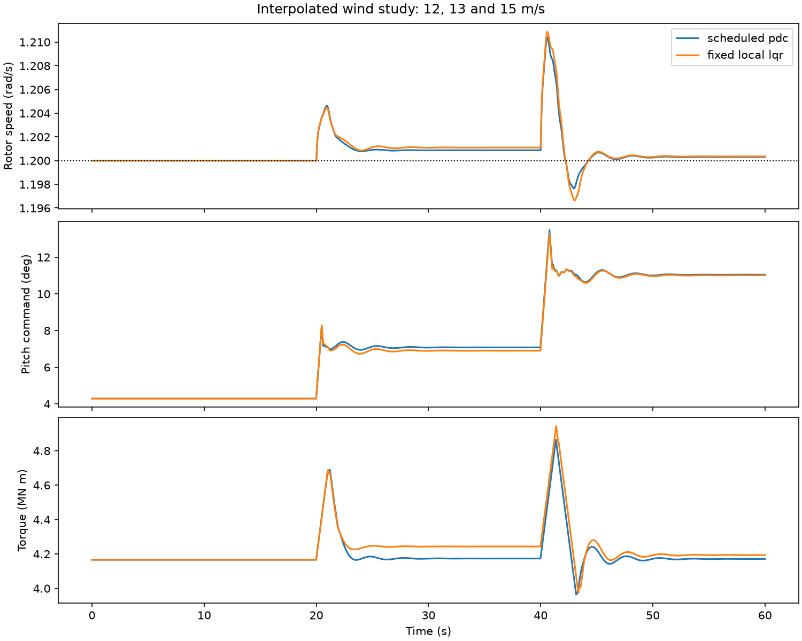

# Wind regulation, LQR and parallel distributed compensation

This executable study completes the controller architecture exercise associated with Section 4.2 of Kroll and Schulte. The design uses the explicitly documented 2022 ROSCO map and newly calculated LQR gains. It is not a recovery of the article's controller, exact turbine map, wind record or Table 12.

## Plant and coordinates

The nine-state model includes four positions, four velocities and pitch. Absolute rotor and generator angles increase at nominal speed. Their common rotation does not affect the loads, so the controller uses eight regulation states:

`[tower deflection, relative blade deflection, shaft torsion, tower velocity, blade velocity, rotor speed, generator speed, pitch]`.

Shaft torsion is rotor angle minus generator angle, with generator quantities referred to the low-speed side. The two commands are generator torque (N m) and demanded pitch (rad). The full plant and the regulation form have identical retained derivatives, including at arbitrary common rotation offsets; this is tested independently.

Three equilibria at 12, 14 and 16 m/s use a rotor speed of 1.2 rad/s and torque `5e6/1.2` N m. Pitch is solved from aerodynamic torque balance inside the available table. Deflections follow thrust/stiffness balance, and shaft torsion follows torque/shaft stiffness. Every equilibrium is substituted into the nonlinear equations before linearization.

## Design and experiment contract

Centered differences produce local linear models. State and input scaling are explicit in [the metrics](results/wind_control_metrics.json), along with the Q and R diagonals. Python solves CARE with SciPy; MATLAB/Octave independently solves the stable invariant-subspace problem without requiring Control System Toolbox. Riccati residuals, positive-semidefinite solutions and closed-loop poles are checked. Numerical gain fixtures link the implementations.

Piecewise-linear weights are nonnegative and sum to one. The PDC action is the weighted sum of the local affine state-feedback laws. Scheduling outside 12-16 m/s raises an error. A fixed middle-point LQR baseline receives the same scheduled equilibrium feedforward, measurements, reference, actuator bounds and rate bounds.

The nonlinear test uses **12, 13 and 15 m/s**, with changes at 20 and 40 seconds. The two interior winds activate multiple memberships, so the test exercises interpolation rather than only switching between stored controllers. Commands are held for 0.02 s and integrated by RK4 for 60 s. A 0.01 s refinement checks sensitivity to the combined control/integration period. Torque is limited to 0-6 MN m with 0.5 MN m/s rate; pitch is limited to 0-30 degrees with 8 degrees/s rate. Aerodynamic lookup rejects extrapolation.



The measured difference between controllers belongs to this single declared synthetic experiment. Interpolation of affine laws need not preserve the exact nonlinear equilibrium at intermediate winds; small speed offsets can remain. Midpoint pole checks and the nonlinear runs are local numerical evidence, not a common Lyapunov certificate or global stability proof. No integral speed-error state is included.

## Explicit model variants

Both languages also implement:

- `rigid_structure`: four states (shaft torsion, rotor/generator speed and pitch), with tower/blade deflections and velocities constrained to zero. The retained drivetrain equations are unchanged.
- `second_order_pitch`: the eight regulation states plus pitch rate; a second-order actuator replaces the first-order pitch law. The demonstration uses natural frequency 10 rad/s and damping ratio 1, explicitly chosen study parameters. An analytical critically damped step response checks the actuator implementation.

These selectable variants make the modeling choices inspectable. Their parameters do not identify the variants' original experimental settings.

## Run and inspect

```bash
python benchmarks/run_wind_control.py
python -m pytest tests/test_wind_control.py -q
```

```matlab
addpath('matlab');
report = validate_wind_control();
trajectory = run_wind_control(true);
points = wind_control('design');
```

The Python implementation is [wind_control.py](../python/intelligent_control/wind_control.py); the independent MATLAB/Octave implementation is [wind_control.m](../matlab/wind_control.m). The results include complete traces, metrics, the plot and a pinned cross-language design fixture. Actual runtime evidence is recorded in [VALIDATION.md](../docs/VALIDATION.md).
