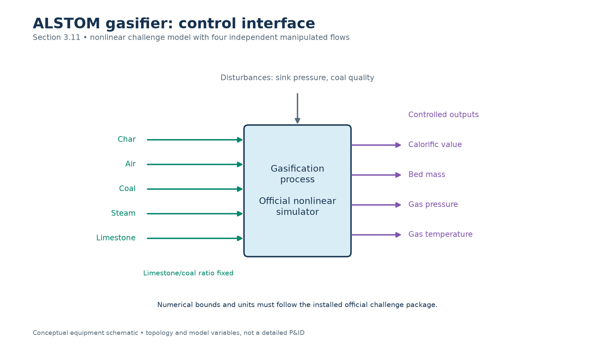
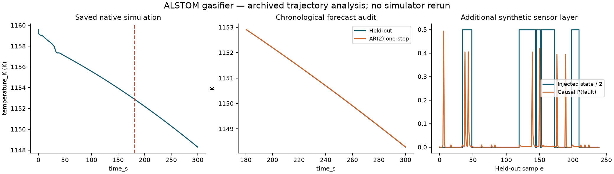

# ALSTOM gasifier: preserved execution and new offline analysis

The source is [benchmarks/results/alstom-native/load050-pressure_step.csv](../../results/alstom-native/load050-pressure_step.csv); SHA-256 `574a36182ed51802e84dd396ccd953b36964158121d4aa4129b78150fb797472`. No simulator was rerun. Chronological output-only AR(2) prediction and additional synthetic sensor HMM. No causal plant identification or new controller evaluation.

The native output is linearly interpolated onto a uniform grid with step 0.500835 in the recorded time unit. The first 360 of 600 samples fit an output-only AR(2); the later segment is held out. One-step physical RMSE is 0.00468434 K. This split is chronological, not an independent experimental campaign. Closed-loop data and unmeasured disturbances prevent a causal plant-identification claim.

Injected HMM evaluation state counts (normal, drift, fault) are [164, 76, 0]. A short record with absent states cannot demonstrate fault recall.

New PI/MPC/fuzzy/evolutionary comparisons require the actual simulator and a matched protocol. Saved trajectories cannot determine a plant response to inputs that were never applied. The sensor panel adds fabricated modes to a known-clean reference; these are not observed equipment faults.

[All nine unit applications](../README.md) · [External simulator access and limits](../../EXTERNAL_MODELS.md)
