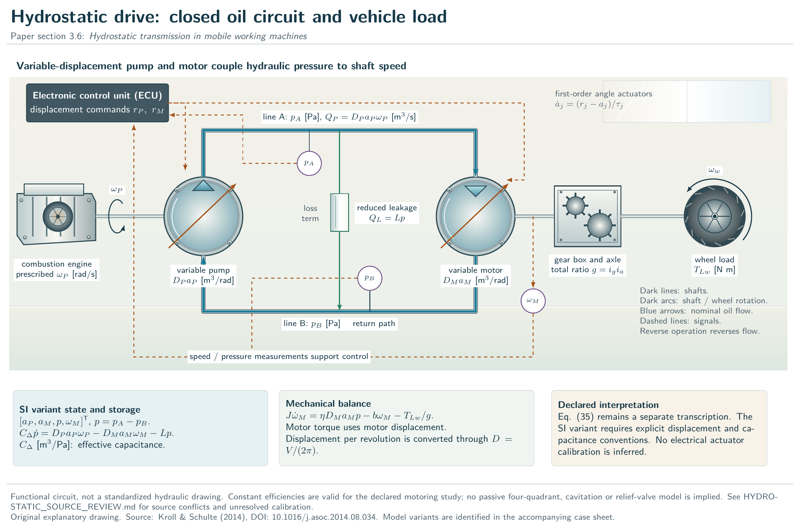
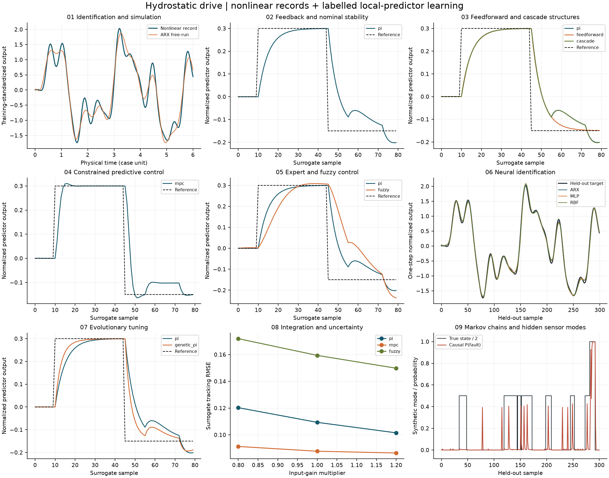

# Hydrostatic drive: nine-stage worked study

Article section **3.6**. Separate SI model: displacement per revolution and effective capacitance; no electrical calibration.

The selected channel is **pump command (normalized) → motor speed (rad/s)**, with time in **s**. All generated records are synthetic. A first-order predictor omits other states and possible channel interactions; its control exercise must not be mistaken for full-plant validation.

| Stage | Worked explanation |
|---|---|
| 1 | [Identification and simulation](../unit-01.md) |
| 2 | [Feedback and nominal stability](../unit-02.md) |
| 3 | [Feedforward and cascade structures](../unit-03.md) |
| 4 | [Constrained predictive control](../unit-04.md) |
| 5 | [Expert and fuzzy control](../unit-05.md) |
| 6 | [Neural identification](../unit-06.md) |
| 7 | [Evolutionary tuning](../unit-07.md) |
| 8 | [Integration and uncertainty](../unit-08.md) |
| 9 | [Markov chains and hidden sensor modes](../unit-09.md) |

[Physical training record](../../results/learning/hydrostatic-train.csv) · [Independent test record](../../results/learning/hydrostatic-test.csv) · [Numerical results and controller traces](../../results/learning/hydrostatic.json)

Read the identification panel before trusting a control curve. A large free-run error, a weak input coefficient or extrapolation beyond the excitation region invalidates an apparatus-level interpretation even when the scalar predictor tracks its target. The external-source and conservation audits remain in [the benchmark guide](../../README.md).
