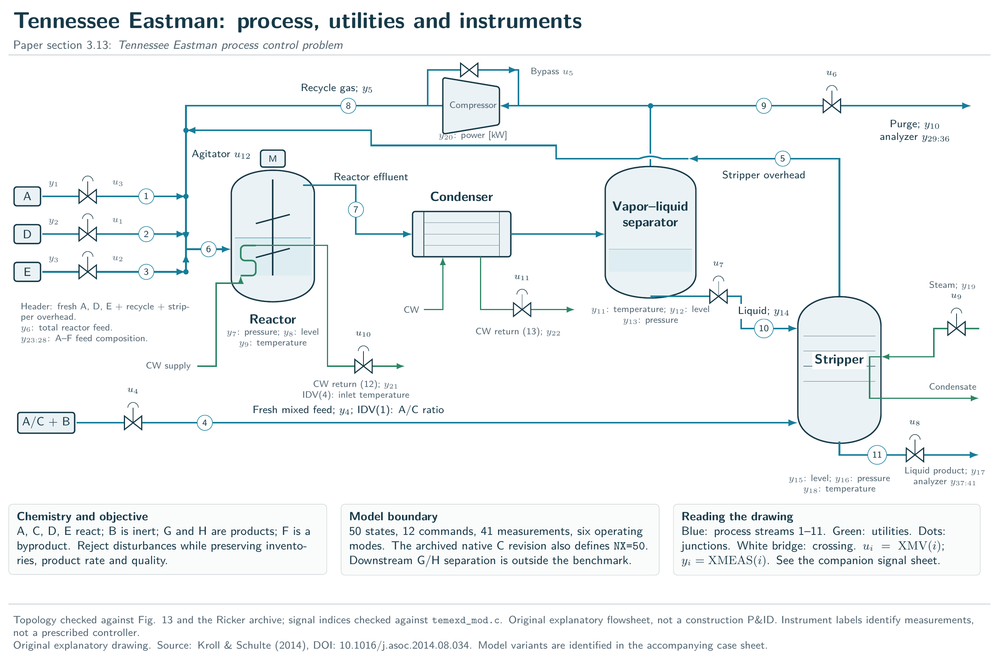
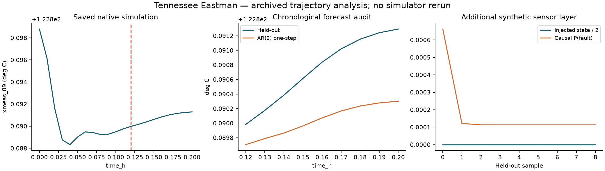

# Tennessee Eastman: preserved execution and new offline analysis

Original article name: **Tennessee Eastman process control problem**, section **3.13**. [Detailed TikZ plate](../../figures/tikz/13-tennessee-eastman.pdf) · [Editable source](../../tikz/13-tennessee-eastman.tex) · [Original-name index](../../DIAGRAMS.md).

The source is [benchmarks/results/te-native/idv-01.csv](../../results/te-native/idv-01.csv); SHA-256 `39abe0d7c07e286074fd4943fbc90af3268ecd5f4d2e3d2c6501c5b94da7f8fe`. No simulator was rerun. Chronological output-only AR(2) prediction and additional synthetic sensor HMM. No causal plant identification or new controller evaluation.

The native output is linearly interpolated onto a uniform grid with step 0.01 in the recorded time unit. The first 12 of 21 samples fit an output-only AR(2); the later segment is held out. One-step physical RMSE is 0.000744605 deg C. This split is chronological, not an independent experimental campaign. Closed-loop data and unmeasured disturbances prevent a causal plant-identification claim.

Injected HMM evaluation state counts (normal, drift, fault) are [9, 0, 0]. A short record with absent states cannot demonstrate fault recall.

New PI/MPC/fuzzy/evolutionary comparisons require the actual simulator and a matched protocol. Saved trajectories cannot determine a plant response to inputs that were never applied. The sensor panel adds fabricated modes to a known-clean reference; these are not observed equipment faults.

[All nine unit applications](../README.md) · [External simulator access and limits](../../EXTERNAL_MODELS.md)
