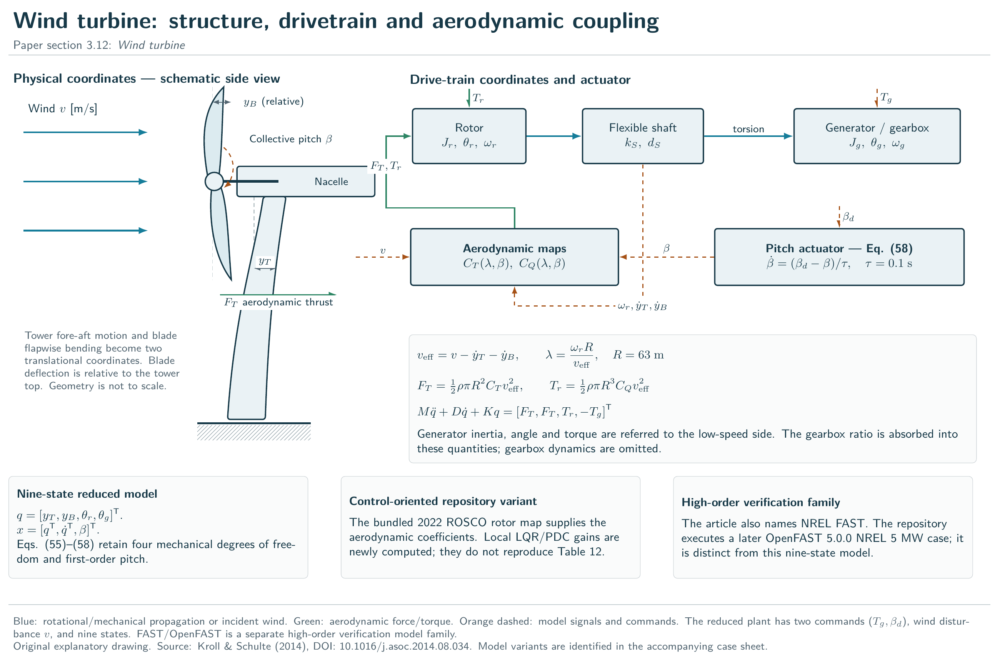
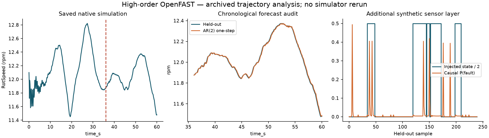

# High-order OpenFAST: preserved execution and new offline analysis

Original article name: **Wind turbine**, section **3.12**. [Detailed TikZ plate](../../figures/tikz/12-wind-turbine.pdf) · [Editable source](../../tikz/12-wind-turbine.tex) · [Original-name index](../../DIAGRAMS.md).

The source is [benchmarks/results/openfast-validation.csv](../../results/openfast-validation.csv); SHA-256 `ce220cd00287744f62e5f4926ef247d8a7d968966efba47a3a4a93c1b084ae8b`. No simulator was rerun. Chronological output-only AR(2) prediction and additional synthetic sensor HMM. No causal plant identification or new controller evaluation.

The native output is linearly interpolated onto a uniform grid with step 0.100167 in the recorded time unit. The first 360 of 600 samples fit an output-only AR(2); the later segment is held out. One-step physical RMSE is 0.00918561 rpm. This split is chronological, not an independent experimental campaign. Closed-loop data and unmeasured disturbances prevent a causal plant-identification claim.

Injected HMM evaluation state counts (normal, drift, fault) are [164, 76, 0]. A short record with absent states cannot demonstrate fault recall.

New PI/MPC/fuzzy/evolutionary comparisons require the actual simulator and a matched protocol. Saved trajectories cannot determine a plant response to inputs that were never applied. The sensor panel adds fabricated modes to a known-clean reference; these are not observed equipment faults.

[All nine unit applications](../README.md) · [External simulator access and limits](../../EXTERNAL_MODELS.md)
