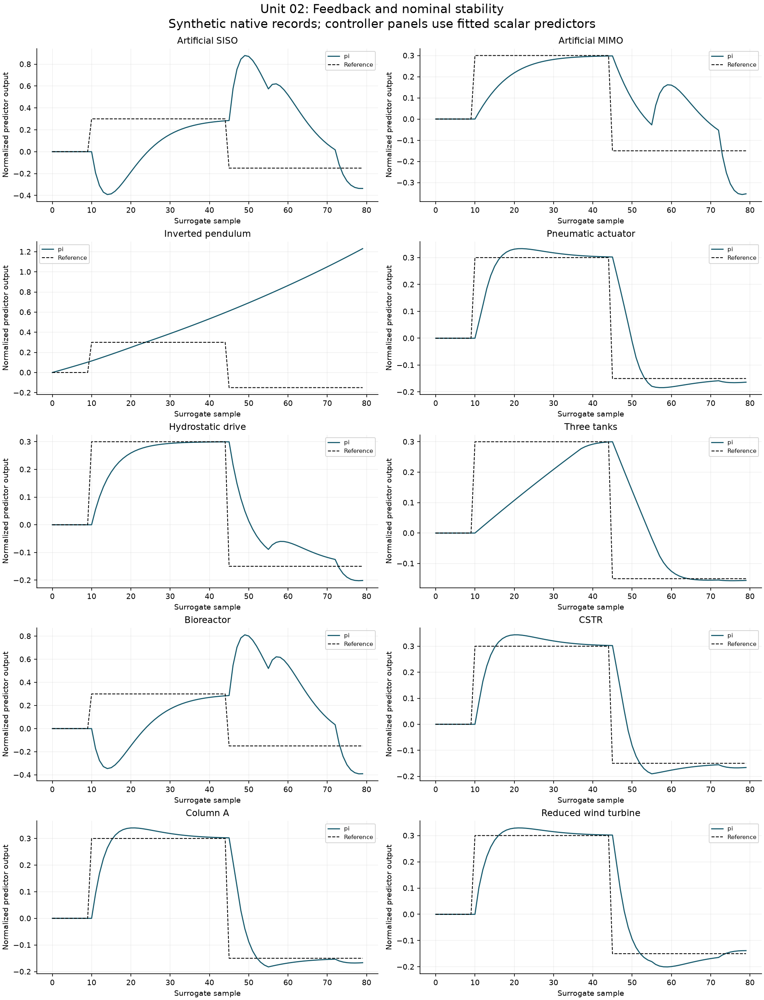

# Unit 02: Feedback and nominal stability across the article benchmarks

Place the two nominal PI predictor poles at $0.80$ and $0.85$: $K_p=(a-0.80\times0.85)/b$ and $K_i=(1-0.80)(1-0.85)/b$. The command includes the current integration increment, $v=K_pe+I+K_ie$, before $I^+=I+K_ie$. Include saturation and conditional integration. These poles refer to the unsaturated scalar predictor; they do not certify the original nonlinear plant.

Each panel reports its own calculation; vertical scales are independent. Normalization makes coordinates comparable in form, not in physical consequence. Read each case before comparing magnitudes.

## Artificial SISO — 3.1 / Eq. 30

Original article name: **Artificial system identification problems**, section **3.1**. [Detailed TikZ plate](../figures/tikz/01-artificial.pdf) · [Editable source](../tikz/01-artificial.tex) · [Original-name index](../DIAGRAMS.md).

Observe **y (dimensionless)** while exciting **u (dimensionless)**; time is **sample**. Exact recurrence; short independent excitation records.

For this case, the held-out ARX one-step RMSE is **0.64162** training standard deviations, versus **0.64182** in free run. The fitted output scale is **1.4763 dimensionless**.
- `pi`: surrogate tracking RMSE **0.4704**, status `completed`, solver failures **0**.

These commands were applied to the fitted affine recurrence only. Before a full-order experiment, restore all states and channels, select an admissible operating point and test physical constraints using the original model.

[Nine-stage case sheet](cases/artificial_siso.md) · [Full numerical record](../results/learning/artificial_siso.json)

## Artificial MIMO — 3.1 / Eq. 31

Original article name: **Artificial system identification problems**, section **3.1**. [Detailed TikZ plate](../figures/tikz/01-artificial.pdf) · [Editable source](../tikz/01-artificial.tex) · [Original-name index](../DIAGRAMS.md).

Observe **y1 (dimensionless)** while exciting **u1 (dimensionless)**; time is **sample**. Both outputs retained; u2 is an independently excited omitted input in the scalar fit.

For this case, the held-out ARX one-step RMSE is **0.20212** training standard deviations, versus **0.29043** in free run. The fitted output scale is **0.82532 dimensionless**.
- `pi`: surrogate tracking RMSE **0.17216**, status `completed`, solver failures **0**.

These commands were applied to the fitted affine recurrence only. Before a full-order experiment, restore all states and channels, select an admissible operating point and test physical constraints using the original model.

[Nine-stage case sheet](cases/artificial_mimo.md) · [Full numerical record](../results/learning/artificial_mimo.json)

## Inverted pendulum — 3.3 / Eq. 32

Original article name: **Cart with inverted pendulum**, section **3.3**. [Detailed TikZ plate](../figures/tikz/03-pendulum.pdf) · [Editable source](../tikz/03-pendulum.tex) · [Original-name index](../DIAGRAMS.md).

Observe **angle (rad)** while exciting **force (N)**; time is **s**. Short upright-window experiment; cart Coulomb friction explicitly set to zero, as in the existing local study.

For this case, the held-out ARX one-step RMSE is **0.0011983** training standard deviations, versus **0.26502** in free run. The fitted output scale is **0.0059305 rad**.
- `pi`: surrogate tracking RMSE **0.71731**, status `completed`, solver failures **0**.

These commands were applied to the fitted affine recurrence only. Before a full-order experiment, restore all states and channels, select an admissible operating point and test physical constraints using the original model.

[Nine-stage case sheet](cases/pendulum.md) · [Full numerical record](../results/learning/pendulum.json)

## Pneumatic actuator — 3.5

Original article name: **Servo-pneumatic actuator**, section **3.5**. [Detailed TikZ plate](../figures/tikz/05-pneumatic.pdf) · [Editable source](../tikz/05-pneumatic.tex) · [Original-name index](../DIAGRAMS.md).

Observe **position (m)** while exciting **valve command (V)**; time is **s**. Separate six-state mass/energy interpretation; assumed valve closure, not apparatus calibration.

For this case, the held-out ARX one-step RMSE is **0.04583** training standard deviations, versus **34.728** in free run. The fitted output scale is **1.864e-05 m**.
- `pi`: surrogate tracking RMSE **0.10185**, status `completed`, solver failures **0**.

These commands were applied to the fitted affine recurrence only. Before a full-order experiment, restore all states and channels, select an admissible operating point and test physical constraints using the original model.

[Nine-stage case sheet](cases/pneumatic.md) · [Full numerical record](../results/learning/pneumatic.json)

## Hydrostatic drive — 3.6

Original article name: **Hydrostatic transmission in mobile working machines**, section **3.6**. [Detailed TikZ plate](../figures/tikz/06-hydrostatic.pdf) · [Editable source](../tikz/06-hydrostatic.tex) · [Original-name index](../DIAGRAMS.md).

Observe **motor speed (rad/s)** while exciting **pump command (normalized)**; time is **s**. Separate SI model: displacement per revolution and effective capacitance; no electrical calibration.

For this case, the held-out ARX one-step RMSE is **0.055806** training standard deviations, versus **0.1972** in free run. The fitted output scale is **0.99344 rad/s**.
- `pi`: surrogate tracking RMSE **0.10933**, status `completed`, solver failures **0**.

These commands were applied to the fitted affine recurrence only. Before a full-order experiment, restore all states and channels, select an admissible operating point and test physical constraints using the original model.

[Nine-stage case sheet](cases/hydrostatic.md) · [Full numerical record](../results/learning/hydrostatic.json)

## Three tanks — 3.7 / Eq. 36

Original article name: **Three-tank-system**, section **3.7**. [Detailed TikZ plate](../figures/tikz/07-three-tanks.pdf) · [Editable source](../tikz/07-three-tanks.tex) · [Original-name index](../DIAGRAMS.md).

Observe **h1 (m)** while exciting **q1 (m3/s)**; time is **s**. Nominal drains remain closed; positive pumping has no steady equilibrium. Surrogate tracking is not physical tank regulation.

For this case, the held-out ARX one-step RMSE is **0.0018237** training standard deviations, versus **0.06048** in free run. The fitted output scale is **0.0013864 m**.
- `pi`: surrogate tracking RMSE **0.15629**, status `completed`, solver failures **0**.

These commands were applied to the fitted affine recurrence only. Before a full-order experiment, restore all states and channels, select an admissible operating point and test physical constraints using the original model.

[Nine-stage case sheet](cases/three_tank.md) · [Full numerical record](../results/learning/three_tank.json)

## Bioreactor — 3.8 / Eq. 37

Original article name: **Continuously operated bio-chemical reactor**, section **3.8**. [Detailed TikZ plate](../figures/tikz/08-bioreactor.pdf) · [Editable source](../tikz/08-bioreactor.tex) · [Original-name index](../DIAGRAMS.md).

Observe **biomass (dimensionless)** while exciting **dilution (dimensionless)**; time is **dimensionless**. Paper sampled model: 50 Euler substeps of 0.01 per 0.5 hold.

For this case, the held-out ARX one-step RMSE is **0.01156** training standard deviations, versus **0.011917** in free run. The fitted output scale is **0.00034845 dimensionless**.
- `pi`: surrogate tracking RMSE **0.45449**, status `completed`, solver failures **0**.

These commands were applied to the fitted affine recurrence only. Before a full-order experiment, restore all states and channels, select an admissible operating point and test physical constraints using the original model.

[Nine-stage case sheet](cases/bioreactor.md) · [Full numerical record](../results/learning/bioreactor.json)

## CSTR — 3.9 / Eqs. 39-43

Original article name: **Continuously stirred chemical reactor**, section **3.9**. [Detailed TikZ plate](../figures/tikz/09-cstr.pdf) · [Editable source](../tikz/09-cstr.tex) · [Original-name index](../DIAGRAMS.md).

Observe **reactor temperature (deg C)** while exciting **cooling (MJ/h)**; time is **h**. Rounded SP1 initial state; dilution held at 8.256/h; short excitation around -6.239 MJ/h.

For this case, the held-out ARX one-step RMSE is **0.021631** training standard deviations, versus **26.579** in free run. The fitted output scale is **0.0264 deg C**.
- `pi`: surrogate tracking RMSE **0.0922**, status `completed`, solver failures **0**.

These commands were applied to the fitted affine recurrence only. Before a full-order experiment, restore all states and channels, select an admissible operating point and test physical constraints using the original model.

[Nine-stage case sheet](cases/cstr.md) · [Full numerical record](../results/learning/cstr.json)

## Column A — 3.10

Original article name: **Continuously operated binary distillation column**, section **3.10**. [Detailed TikZ plate](../figures/tikz/10-column-a.pdf) · [Editable source](../tikz/10-column-a.tex) · [Original-name index](../DIAGRAMS.md).

Observe **top composition (mole fraction)** while exciting **reflux (kmol/min)**; time is **min**. 82-state LV model; separate end-vessel P level loops, gain 10/min; boilup held fixed.

For this case, the held-out ARX one-step RMSE is **0.013855** training standard deviations, versus **6.8907** in free run. The fitted output scale is **2.3974e-05 mole fraction**.
- `pi`: surrogate tracking RMSE **0.089344**, status `completed`, solver failures **0**.

These commands were applied to the fitted affine recurrence only. Before a full-order experiment, restore all states and channels, select an admissible operating point and test physical constraints using the original model.

[Nine-stage case sheet](cases/column_a.md) · [Full numerical record](../results/learning/column_a.json)

## Reduced wind turbine — 3.12 and 4.2

Original article name: **Wind turbine**, section **3.12**. [Detailed TikZ plate](../figures/tikz/12-wind-turbine.pdf) · [Editable source](../tikz/12-wind-turbine.tex) · [Original-name index](../DIAGRAMS.md).

Observe **rotor speed (rad/s)** while exciting **generator torque (N m)**; time is **s**. Eight regulation coordinates of the nine-state plant, constant wind 14 m/s, later ROSCO map; no historical Table 12 claim.

For this case, the held-out ARX one-step RMSE is **0.0027328** training standard deviations, versus **0.04965** in free run. The fitted output scale is **0.0008022 rad/s**.
- `pi`: surrogate tracking RMSE **0.087594**, status `completed`, solver failures **0**.

These commands were applied to the fitted affine recurrence only. Before a full-order experiment, restore all states and channels, select an admissible operating point and test physical constraints using the original model.

[Nine-stage case sheet](cases/wind_reduced.md) · [Full numerical record](../results/learning/wind_reduced.json)

## External models and unavailable measured records

### ALSTOM gasifier

Original article name: **ALSTOM Gasifier Control Benchmark II**, section **3.11**. [Detailed TikZ plate](../figures/tikz/11-gasifier.pdf) · [Editable source](../tikz/11-gasifier.tex) · [Original-name index](../DIAGRAMS.md).

The preserved native trace provides **600** selected samples of `temperature_K`. Output-only held-out prediction RMSE is **0.0046843 K**. [Illustrated trace audit](cases/gasifier.md).

Units 1/6 use this as an output-prediction and provenance exercise, unit 8 reviews the preserved validation limits, and unit 9 adds a separate synthetic sensor layer. Units 2–5/7 specify a controller-design protocol but are **not newly executed** on this external plant: archived trajectories cannot be replayed as counterfactual responses to different inputs. Restore the pinned simulator, operating modes, actuator channels and disturbance protocol before redesigning control.

### High-order OpenFAST

Original article name: **Wind turbine**, section **3.12**. [Detailed TikZ plate](../figures/tikz/12-wind-turbine.pdf) · [Editable source](../tikz/12-wind-turbine.tex) · [Original-name index](../DIAGRAMS.md).

The preserved native trace provides **600** selected samples of `RotSpeed`. Output-only held-out prediction RMSE is **0.0091856 rpm**. [Illustrated trace audit](cases/wind_fast.md).

Units 1/6 use this as an output-prediction and provenance exercise, unit 8 reviews the preserved validation limits, and unit 9 adds a separate synthetic sensor layer. Units 2–5/7 specify a controller-design protocol but are **not newly executed** on this external plant: archived trajectories cannot be replayed as counterfactual responses to different inputs. Restore the pinned simulator, operating modes, actuator channels and disturbance protocol before redesigning control.

### Tennessee Eastman

Original article name: **Tennessee Eastman process control problem**, section **3.13**. [Detailed TikZ plate](../figures/tikz/13-tennessee-eastman.pdf) · [Editable source](../tikz/13-tennessee-eastman.tex) · [Original-name index](../DIAGRAMS.md).

The preserved native trace provides **21** selected samples of `xmeas_09`. Output-only held-out prediction RMSE is **0.00074461 deg C**. [Illustrated trace audit](cases/tennessee_eastman.md).

Units 1/6 use this as an output-prediction and provenance exercise, unit 8 reviews the preserved validation limits, and unit 9 adds a separate synthetic sensor layer. Units 2–5/7 specify a controller-design protocol but are **not newly executed** on this external plant: archived trajectories cannot be replayed as counterfactual responses to different inputs. Restore the pinned simulator, operating modes, actuator channels and disturbance protocol before redesigning control.

### Throttle and identification repositories

Original article name: **Electro-mechanical throttle**, section **3.4**. [Detailed TikZ plate](../figures/tikz/04-throttle.pdf) · [Editable source](../tikz/04-throttle.tex) · [Original-name index](../DIAGRAMS.md).

Original article name: **Data repositories for system identification and regression**, section **3.2**. [Detailed TikZ plate](../figures/tikz/02-datasets.pdf) · [Editable source](../tikz/02-datasets.tex) · [Original-name index](../DIAGRAMS.md).

Original throttle measurements remain unavailable. The strict 10,000/2,500-row importer and synthetic fixture tests are documented in [the recovery record](../THROTTLE_RECOVERY.md); no new figure is labeled as measured throttle performance. For section 3.2, first choose and license a specific dataset from [the register](../DATASETS.md), preserve its original split and units, and record its hash. Model fitting, controller design and fault calibration stay pending until those inputs exist.

[All units and cases](README.md) · [Source equations and boundaries](../README.md)
