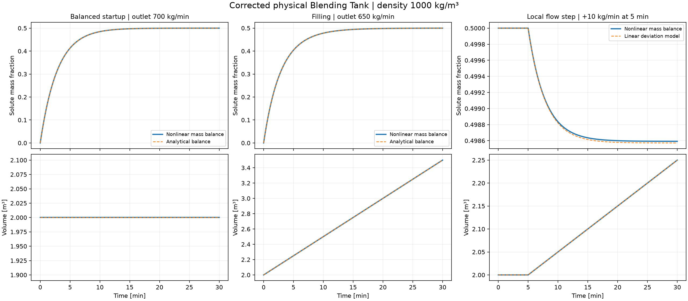

# Corrected physical Blending Tank

This physical Blending Tank model derives its equations, operating points and transfer functions from conservation laws. The implementation uses explicit mass-flow units and variable volume, distinct from the normalized 100 L teaching tank used throughout the nine course units.

## Run the corrected version

```bash
python -m pip install -r requirements.txt
python blending-tank/run_study.py
python -m pytest tests/test_physical_blending.py -q
```

[](https://colab.research.google.com/github/fobos123deimos/Undergraduate-Course-Intelligent-Systems-for-Process-Control-and-Automation/blob/main/blending-tank/notebook.ipynb)

[Executed notebook](notebook.ipynb) · [Computed results](results/metrics.json) · [Python equations](../python/intelligent_control/physical_blending.py) · [MATLAB equations](../matlab/bt_rhs.m) · [Validation evidence](VALIDATION.md)

For MATLAB or GNU Octave, from the repository root:

```matlab
addpath('matlab');
result = run_blending_tank(true);
validate_blending_tank;
```

Fresh Simulink diagrams are generated separately using MATLAB with Simulink:

```matlab
addpath('matlab'); addpath('simulink');
paths = build_blending_tank();
validate_blending_simulink;
```

The generator builds a nonlinear physical model and a comparison of nonlinear, state-space and transfer-function branches. It refuses to overwrite existing files by default. Simulink generation and execution require that runtime; see the validation record for the distinction between tested numerical functions and unexecuted Simulink sources.

## State, inputs and units

| Quantity | Meaning | Unit |
|---|---|---|
| `X` | Tank solute mass fraction | dimensionless, between 0 and 1 |
| `V` | Liquid volume | m³ |
| `w1`, `w2`, `wout` | Inlet and outlet mass flows | kg/min |
| `x1`, `x2` | Inlet solute mass fractions | dimensionless, between 0 and 1 |
| `rho` | Constant liquid density | kg/m³ |
| `t` | Time | min |

Every interface uses **state order `[X,V]`** and **input order `[w1,w2,x1,x2,wout]`**. A volumetric flow must first be converted with `w = rho*q`; it cannot be inserted as a mass flow. The explicit default density is **1000 kg/m³**, a declared study assumption.

## Conservation equations

Assume a perfectly mixed, single-phase, nonreacting liquid of constant density. The outlet concentration equals the tank concentration:

$$\frac{d(\rho V)}{dt}=w_1+w_2-w_{out},\qquad
\frac{d(\rho VX)}{dt}=w_1x_1+w_2x_2-w_{out}X.$$

Applying the product rule and substituting the total-mass balance gives

$$\dot V=\frac{w_1+w_2-w_{out}}{\rho},\qquad
\dot X=\frac{w_1(x_1-X)+w_2(x_2-X)}{\rho V}.$$

The outlet flow cancels explicitly in the concentration equation, but still affects its dynamics through volume. Finite positive density and volume, nonnegative flows and admissible fractions are checked. For known piecewise-constant inputs, the exact volume trajectory is checked before integration; a requested run reaching the minimum volume is rejected rather than integrated through the singularity. No vessel capacity or overflow mechanism is assumed without specification.

## Equilibrium and corrected linear model

The default equilibrium is

$$\bar u=[500,200,0.4,0.75,700]^T,\quad
\bar x=[0.5,2]^T,\quad \rho=1000.$$

The outlet equals the sum of the inlets. The equilibrium fraction is `(500*0.4 + 200*0.75)/700 = 0.5`. With no volume-dependent outlet law, the balanced tank admits any positive equilibrium volume; 2 m³ specifies the chosen operating point.

Define deviations `delta_x = x - xbar` and `delta_u = u - ubar`. The first-order model is

$$\delta\dot x=A\delta x+B\delta u,\quad
A=\begin{bmatrix}-0.35&0\\0&0\end{bmatrix},\quad
B=\begin{bmatrix}-0.00005&0.000125&0.25&0.10&0\\0.001&0.001&0&0&-0.001\end{bmatrix}.$$

Use `C = eye(2)` and `D = zeros(2,5)`, and restore absolute outputs with `x = xbar + delta_x`. The concentration pole is −0.35 min⁻¹, giving a nominal time constant of 2.85714 min. Volume has an integrator: constant flow imbalance accumulates volume.

The transfer matrix maps **input deviations to output deviations**:

$$G(s)=\begin{bmatrix}
\frac{-0.00005}{s+0.35}&\frac{0.000125}{s+0.35}&\frac{0.25}{s+0.35}&\frac{0.10}{s+0.35}&0\\
\frac{0.001}{s}&\frac{0.001}{s}&0&0&\frac{-0.001}{s}
\end{bmatrix}.$$

These are zero-initial-deviation transfer functions. The negative first concentration channel is required: increasing the more dilute inlet lowers the equilibrium concentration. Transfer coefficients are calculated from the Jacobian using the declared density of 1000 kg/m³.

Away from equilibrium, the general Jacobian includes `A(1,2) = -fX/V`. A local Taylor approximation must retain the constant offset `fbar`: `xdot ≈ fbar + A*(x-xbar) + B*(u-ubar)`. Such a frozen affine approximation is not a global linear model of an entire filling trajectory. The equilibrium constructor rejects unbalanced flows.

## Three checked scenarios

1. **Balanced startup:** start at `[X,V]=[0,2]` with outlet 700 kg/min. Compare numerical integration with `X(t)=0.5*(1-exp(-0.35*t))`, `V(t)=2`.
2. **Filling:** set the outlet to 650 kg/min, with the same initial state. Now `V(t)=2+0.05*t` and `X(t)=0.5*(1-(2/V(t))^14)`. This is a valid variable-volume case, not a constant-volume equilibrium.
3. **Local flow perturbation:** start at equilibrium and increase `w1` by 10 kg/min at minute 5. Compare the nonlinear equations with the deviation model under the same physical inputs. The volume response agrees exactly; concentration agreement is local and its error is reported.



CSV files include time, nonlinear states, analytical/linear references and all five physical input channels. Tests independently check conservation, analytical solutions, finite-difference Jacobians, transfer signs, equilibrium offsets, small-perturbation error scaling and physical input rejection. This establishes numerical and mathematical consistency of the stated model, not validation against a real tank or certification of industrial use.
