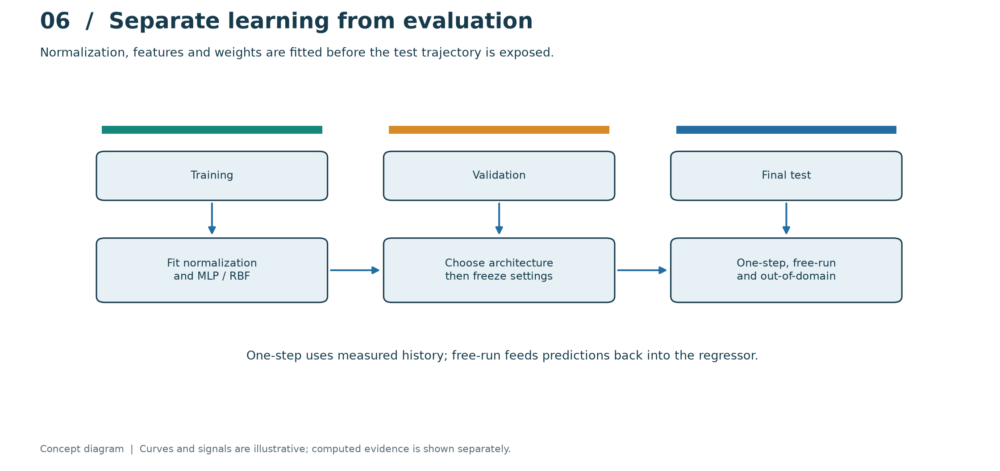
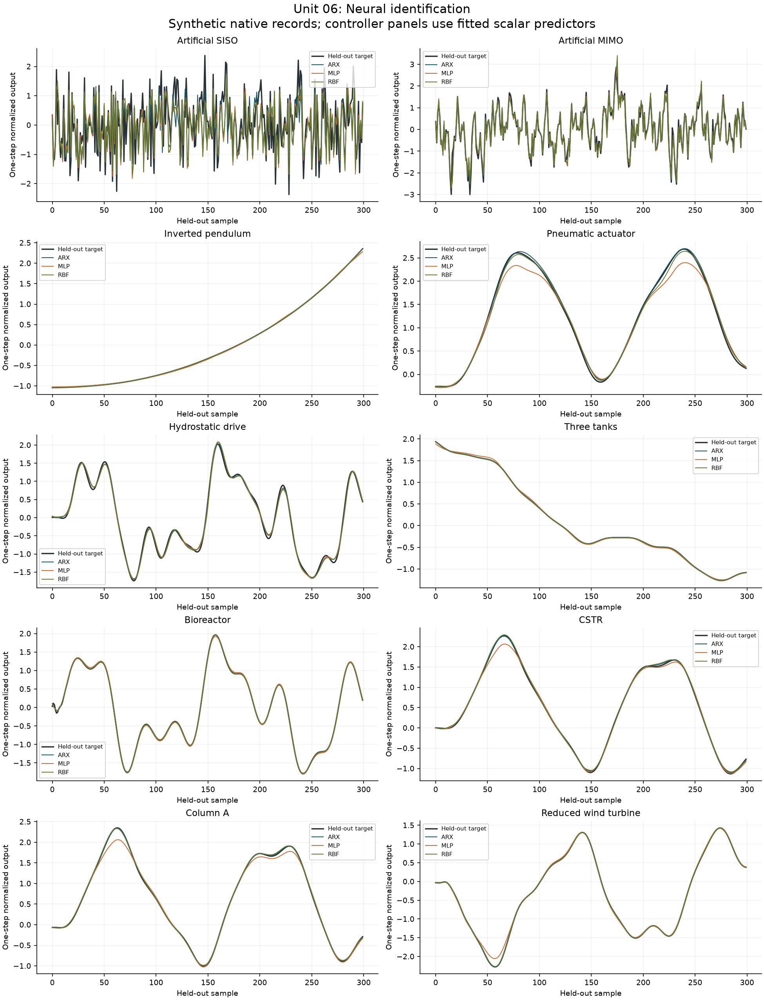

# Unit 06 - Neural modeling and control of dynamic systems

[Course guide](../README.md) · [Notebook](../../laboratories/06-neural-identification-control/notebook.ipynb) · [Exercises](../../problem-sets/06-neural-identification-control/exercises.md) · [Worked solutions](../../problem-sets/06-neural-identification-control/solutions.md)

**Prerequisites:** Units 01, 02 and 04; differentiation, gradients, least squares and separation of training, validation and test data.

## Predict a dynamic relation, not a shuffled collection of rows

A nonlinear autoregressive model with external input uses past observations and applied inputs to predict the next output. One causal choice is

$$
\phi_k=[y_k,y_{k-1},u_k,u_{k-1}]^T,\qquad \hat y_{k+1}=f_\theta(\phi_k).
$$

The regressor timing must be causal. Randomly shuffling heavily overlapping windows before splitting can place nearly identical trajectories in both training and testing. Split trajectories first, then construct lagged windows inside each partition. Save scaling parameters, random seed, architecture, weights and the complete data protocol.

## Four network families address different tasks

A perceptron computes a binary decision from $\operatorname{sign}(w^Tx+b)$ and updates the separating hyperplane on classification mistakes. It is a useful diagnostic classifier for linearly separable conditions, not a continuous process simulator. An MLP composes affine maps and nonlinearities; for one hidden layer, $h=\tanh(W_1\phi+b_1)$ and $\hat y=W_2h+b_2$. Backpropagation differentiates the loss through both layers. Regularization, early stopping and independent validation limit overfitting but do not certify extrapolation.

An RBF network uses local responses $\psi_j(\phi)=\exp[-\|\phi-\mu_j\|^2/(2\sigma_j^2)]$ and a linear output. For fixed centers/widths, ridge regression determines output weights from $(\Psi^T\Psi+\alpha I)w=\Psi^TY$. Poorly placed centers can leave important operating regions unsupported. A self-organizing map (SOM) updates a best-matching unit and its neighbors, $m_j^+=m_j+\eta h_{j,j^*}(x-m_j)$. It organizes operating regimes without supervised target values; a small map distance is not a fault label or a probability.

## Accuracy is a property of the validation experiment

Report one-step and recursive simulation errors, operating-range coverage, residual structure and behavior under changed initial conditions. Normalize errors with a declared physical scale. Preserve the physical concentration interval and compare against the linear identification baseline: a larger network is useful only if it answers a limitation the baseline actually has. Bootstrap or repeated-seed comparisons should resample whole independent runs where temporal correlation matters.

## Use a learned model in control with explicit safeguards

A neural predictor can replace a prediction model inside MPC, or a differentiable inverse can propose an input. For a locally monotone model, a bounded Newton step is $u^+=u-\gamma(\hat y^+(u)-r)/(\partial\hat y^+/\partial u)$. A small or wrong-sign derivative makes this unreliable. Enforce actuator limits, restrict the search to supported inputs, test the candidate against a known model/constraint layer, and retain a validated fallback. Direct inverse learning can be ill-posed when different inputs produce the same output or when unobserved states matter. Good training error does not establish closed-loop stability.

## Computational practice

From the repository root, run `python tools/run_course.py --unit 6`. Use the notebook to inspect assumptions, rerun calculations and compare them with the worked reasoning. The lesson's hypothetical examples illustrate the method; inspect each program's configuration before comparing numerical outputs.

## Visual method and article applications

This conceptual diagram separates the method's signals and information flow from its measured or simulated evidence. Read the [laboratory explanation](../../laboratories/06-neural-identification-control/README.md#read-the-method-visually) alongside the computed traces.

The [worked article study](../../benchmarks/learning/unit-06.md) applies this unit across the equation-based benchmarks and records the chosen local approximations, results and remaining external-data limits.
