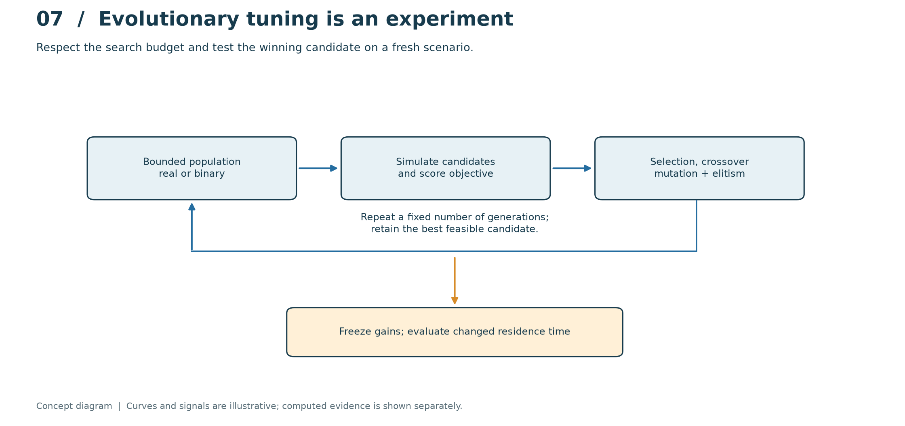
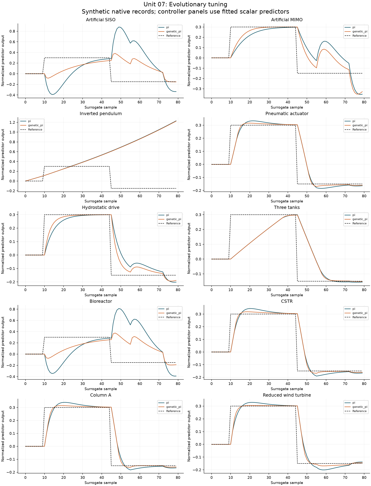

# Unit 07 - Evolutionary optimization and controller tuning

[Course guide](../README.md) · [Notebook](../../laboratories/07-evolutionary-tuning/notebook.ipynb) · [Exercises](../../problem-sets/07-evolutionary-tuning/exercises.md) · [Worked solutions](../../problem-sets/07-evolutionary-tuning/solutions.md)

**Prerequisites:** Units 02, 04 and 06; random sampling, objective functions and constrained experiment design.

## Encode a controller and an experiment together

A genetic algorithm searches a population of candidate parameters through selection, crossover and mutation. For PI tuning the chromosome may encode $(K_p,K_i)$; for multivariable MPC it may encode prediction horizon and positive input/output weights. Bounds and units are part of the representation. A chromosome is not a controller until the decoding, simulation protocol, constraints and cost are defined.

For a $b$-bit unsigned integer $q$, a parameter in $[l,h]$ is $\theta=l+(h-l)q/(2^b-1)$. Binary encoding creates quantization and bit-level neighborhoods that may differ strongly from physical distance. Real encoding avoids that quantization but still needs a documented crossover and mutation distribution. Blend crossover $\theta_c=\alpha\theta_1+(1-\alpha)\theta_2$ stays inside the parental interval when $0\leq\alpha\leq1$; Gaussian mutation may leave bounds, so repair or rejection must be specified.

## Reward what matters and reject invalid trials

One cost is $J=\mathrm{IAE}+\beta\sum_k|u_k-u_{k-1}|+\gamma\sum_k\epsilon_k^2$, where $\epsilon$ measures permitted soft violations. Normalize terms or state their units before choosing weights. Hard physical limits should be enforced or treated as candidate rejection, not hidden by an average penalty. Terminate unstable simulations using declared state/finite-value thresholds and give them a consistently poor fitness.

Tournament selection needs only an ordering, whereas fitness-proportional selection needs nonnegative appropriately scaled fitness. Elitism preserves the best observed valid candidate; it does not establish a global optimum. Count simulation evaluations, not just generations, when comparing computational budgets. Include a grid, random search or established IMC tuning baseline so improvement can be attributed to the search method rather than additional evaluation effort.

## Separate tuning scenarios from final evaluation

Optimize against a fixed family of training trajectories, select algorithm settings using validation scenarios, then freeze the design before testing unseen disturbances and plant mismatch. Repeated seeds reveal stochastic search variability; report the distribution and all failed runs, not only the best seed. For uncertain models, use a declared robust objective such as the maximum cost across a finite scenario set; this is robustness to that tested set, not a proof for all uncertainty.

For multivariable MPC, chromosomes must retain positive weights and integer horizons. Changing a weight changes both performance and the meaning of a reported objective; compare final controllers using a common external evaluation metric. Include solve-time and feasibility effects because a long horizon that misses the deadline is not an operational improvement.

## Computational practice

From the repository root, run `python tools/run_course.py --unit 7`. Use the notebook to inspect assumptions, rerun calculations and compare them with the worked reasoning. The lesson's hypothetical examples illustrate the method; inspect each program's configuration before comparing numerical outputs.

## Visual method and article applications

This conceptual diagram separates the method's signals and information flow from its measured or simulated evidence. Read the [laboratory explanation](../../laboratories/07-evolutionary-tuning/README.md#read-the-method-visually) alongside the computed traces.

The [worked article study](../../benchmarks/learning/unit-07.md) applies this unit across the equation-based benchmarks and records the chosen local approximations, results and remaining external-data limits.
