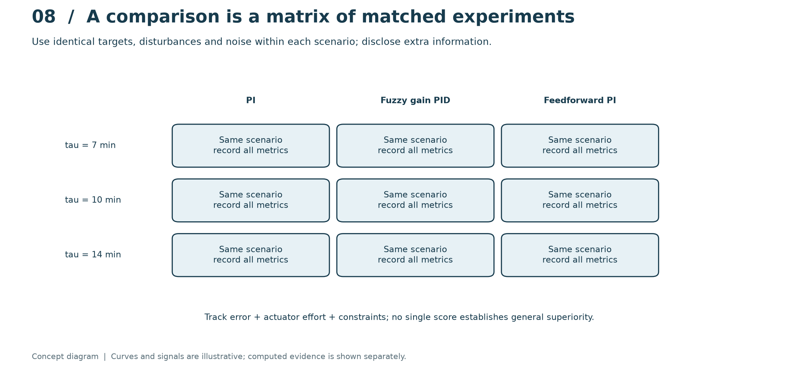
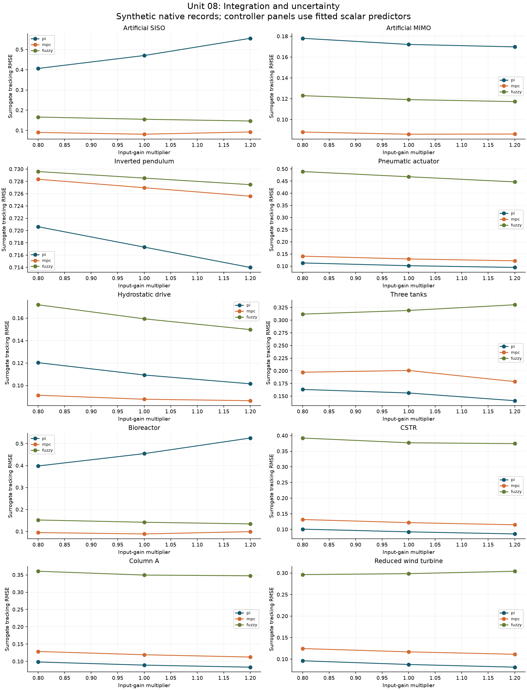

# Unit 08 - Integration, benchmark evidence and technical communication

[Course guide](../README.md) · [Notebook](../../laboratories/08-integrated-validation/notebook.ipynb) · [Exercises](../../problem-sets/08-integrated-validation/exercises.md) · [Worked solutions](../../problem-sets/08-integrated-validation/solutions.md)

**Prerequisites:** Units 01-07; interpretation of numerical experiments and model limitations.

## A comparison is a controlled experiment

Start by stating the plant, operating range, measured variables, actuator limits and decision question. Establish the physical and linear identification baselines before adding neural or fuzzy components. Freeze a shared experiment contract: sample interval, numerical solver and tolerance, initial state, reference, disturbances, noise realization, controller initialization and failure policy. Keep synthetic outputs distinct from measured records. A simulation-based controller study is evidence about its declared model and scenarios.

Use the supplied integrated syllabus as a non-official study framework. The three proposed practical blocks become one connected project: identify and tune a baseline; compare alternative structures and MPC; then add an intelligent method and test its incremental value. Do not give every method a different experiment merely because one plot looks better.

## Match the article's model identity before its score

Kroll and Schulte's article provides a benchmark survey, not a single self-contained software package. Its sections include artificial SISO and MIMO identification models; data repositories; an inverted pendulum; throttle; pneumatic actuation; hydrostatic transmission; three tanks; a bioreactor; a chemical CSTR; a binary distillation column; the ALSTOM gasifier; wind-turbine models; and the Tennessee Eastman process. Some examples specify equations; others require external data, maps, parameter choices or full reference simulators.

Record the section, equation/model variant, source version, parameters, units and any closure added by the implementation. An educational closure can illuminate a mechanism, but its results do not reproduce an external industrial benchmark. Missing physical functions must remain a visible dependency rather than be replaced by an arbitrary function with the original benchmark's name. The repository's benchmark inventory is the authority for implemented versus externally dependent cases.

## Evaluate performance and limitations jointly

Prediction metrics include maximum absolute error, SSE, RMSE, VAF and $R^2$. VAF uses residual variance while $R^2$ uses residual squared magnitude, so a constant bias can leave VAF deceptively high. For constant targets, denominator-based metrics may be undefined; report absolute errors rather than inventing a finite score. Control metrics include IAE/ISE, peak error, settling under a stated band/dwell rule, applied effort, total variation, saturation and violations. Analyze trajectories as well as aggregates.

## Communicate a reviewable conclusion

A technical report should connect requirements, derivation, implementation, experiment, result and limitation. Include a physical equipment diagram, a control architecture diagram and axes with units. Give enough code and configuration to reproduce every reported value. State which language/runtime was actually executed. An unrun MATLAB or Simulink port must not be presented as experimentally verified merely because Python passed.

Present improvements as conditional results: for this model, this information set and these tests, the observed tradeoff was favorable. Explain failures and unsupported extrapolation. A useful next decision may be to collect a missing measurement or validate a plant parameter, rather than introduce another algorithm.

## Computational practice

From the repository root, run `python tools/run_course.py --unit 8`. Use the notebook to inspect assumptions, rerun calculations and compare them with the worked reasoning. The lesson's hypothetical examples illustrate the method; inspect each program's configuration before comparing numerical outputs.

## Visual method and article applications

This conceptual diagram separates the method's signals and information flow from its measured or simulated evidence. Read the [laboratory explanation](../../laboratories/08-integrated-validation/README.md#read-the-method-visually) alongside the computed traces.

The [worked article study](../../benchmarks/learning/unit-08.md) applies this unit across the equation-based benchmarks and records the chosen local approximations, results and remaining external-data limits.
