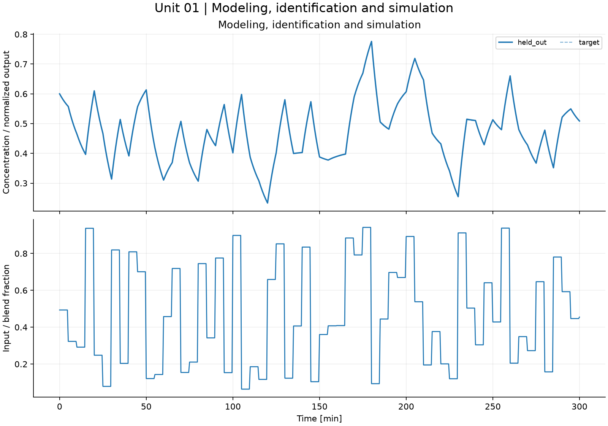
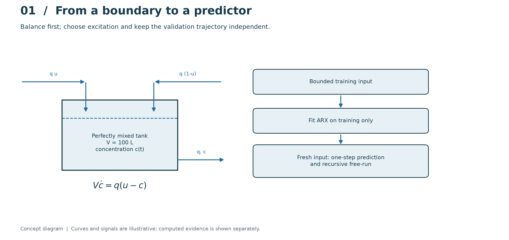
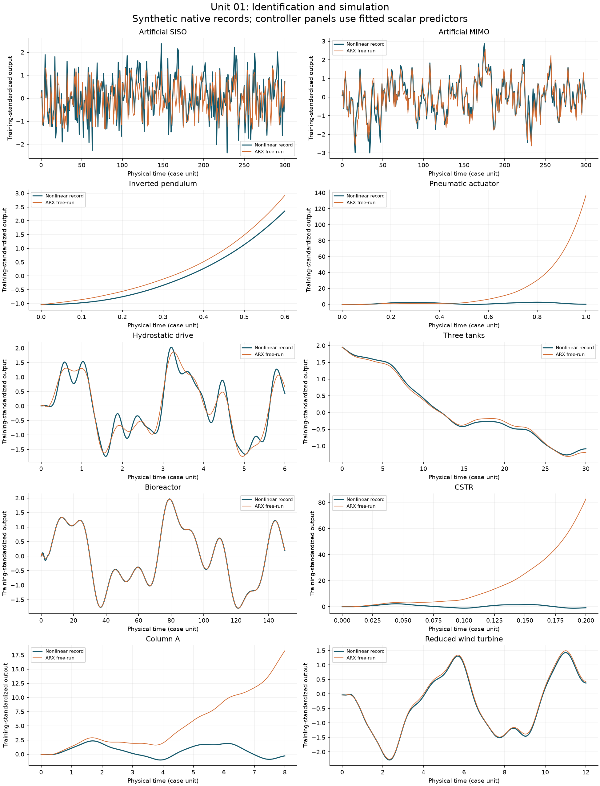

# 01. Modeling, identification and simulation

[](https://colab.research.google.com/github/fobos123deimos/Undergraduate-Course-Intelligent-Systems-for-Process-Control-and-Automation/blob/main/laboratories/01-modeling-identification/notebook.ipynb)

A well-mixed, constant-volume tank obeys $V\dot c=q(u-c)$.
With $V=100$ L and $q=10$ L/min, $G(s)=1/(10s+1)$ and
$c_{k+1}=a c_k+(1-a)u_k$, where $a=\exp(-T_s/10)$.
Estimate an ARX model from a persistently exciting experiment, then assess
one-step prediction and recursive free-run on a fresh input sequence.
Noise on the autoregressive regressor can bias least squares; a small residual
does not prove physical parameter accuracy.

```bash
python tools/run_course.py --unit 1
```

[Notebook](notebook.ipynb) · [Metrics](results/metrics.json) · [Course notes](../../course/README.md) · [Problems and solutions](../../problem-sets/README.md)



## Read the method visually



Read the tank boundary from left to right: the two inlet streams mix, the outlet carries the current concentration, and balanced total flow fixes the volume. The right-hand diagram separates training from an independent validation input. In the computed figure, compare the training excitation with the held-out one-step and recursive traces; the latter propagates its own errors.

The conceptual diagram is deliberately separate from the computed experiment below. [Editable SVG](../../course/figures/learning/unit-01.svg).

## Apply this unit to the article benchmarks

[Worked benchmark study for Unit 01](../../benchmarks/learning/unit-01.md)



Read the per-model method, chosen signals, numerical results and interpretation in the linked study. The learning track declares its local-model approximations and separates equation-based experiments from external datasets and simulators. It does not turn an unavailable measured record into a synthetic benchmark result.
