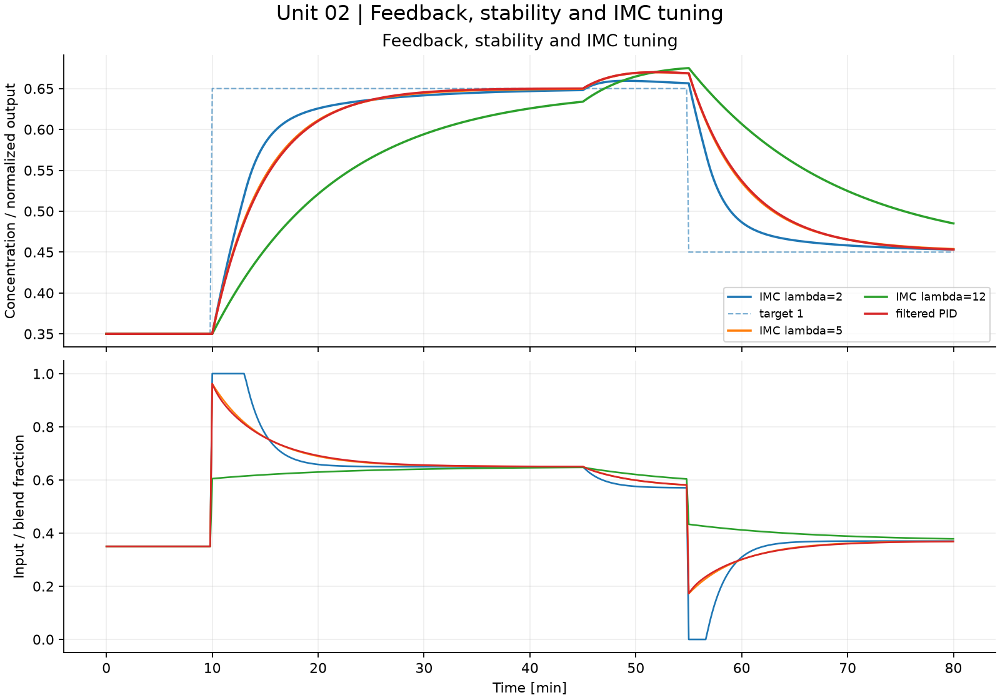
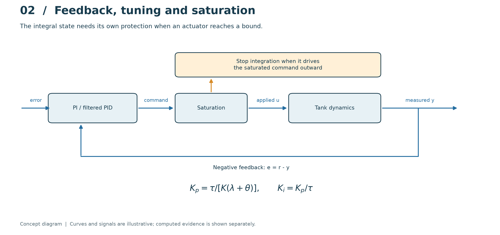
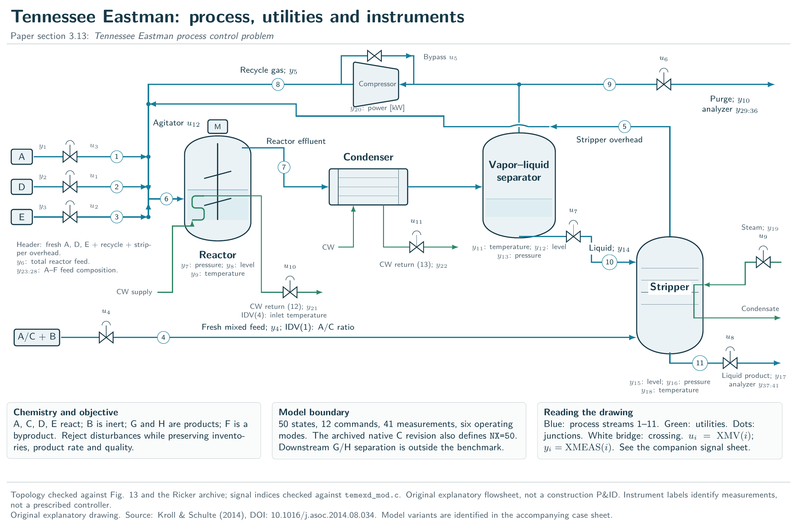
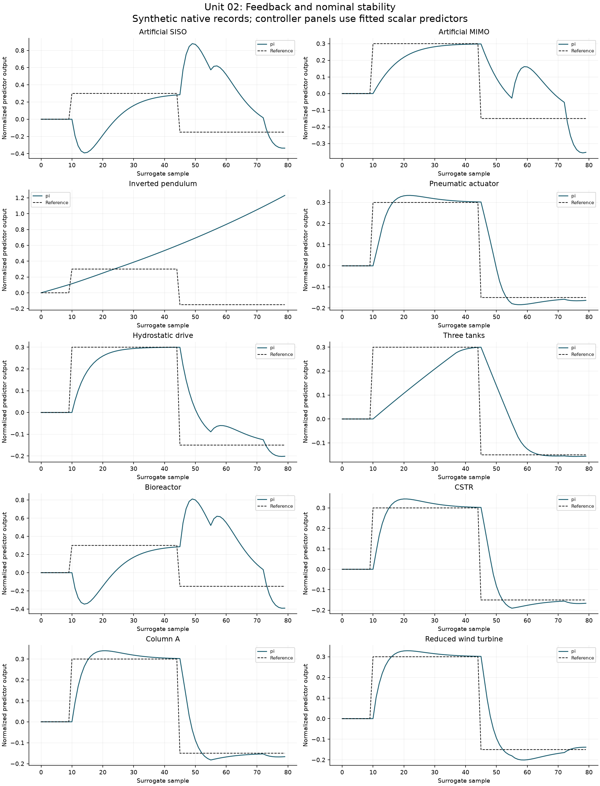

# 02. Feedback, stability and IMC tuning

[](https://colab.research.google.com/github/fobos123deimos/Undergraduate-Course-Intelligent-Systems-for-Process-Control-and-Automation/blob/main/laboratories/02-feedback-imc/notebook.ipynb)

The IMC-inspired PI tuning for a FOPDT approximation is
$K_p=\tau/[K(\lambda+\theta)]$, $K_i=K_p/\tau$.
For the nominal tank, the characteristic polynomial is
$10s^2+(1+K_p)s+K_i$. Positive coefficients establish stability of this
second-order continuous nominal loop. Saturation and sampling still require
separate simulation. Conditional integration prevents an integral state
from growing while it would drive a saturated actuator further outward.

```bash
python tools/run_course.py --unit 2
```

[Notebook](notebook.ipynb) · [Metrics](results/metrics.json) · [Course notes](../../course/README.md) · [Problems and solutions](../../problem-sets/README.md)



## Read the method visually



Follow the command through saturation before it reaches the plant. The feedback path closes on the measured output, while conditional integration protects the integral state. In the computed comparison, locate the reference change and distinguish a faster transient from increased actuator movement; a nominal stability calculation does not remove saturation effects.

The conceptual diagram is deliberately separate from the computed experiment below. [Editable SVG](../../course/figures/learning/unit-02.svg).

## Apply this unit to the article benchmarks

[Original article names and detailed TikZ atlas](../../benchmarks/DIAGRAMS.md) · [Download the vector atlas](../../benchmarks/figures/tikz/benchmark-atlas.pdf)



The atlas identifies every benchmark by its original paper name and repository alias, with equipment, states and signals. The Tennessee Eastman companion plate maps the 12 commands and 41 measurements.

[Worked benchmark study for Unit 02](../../benchmarks/learning/unit-02.md)



Read the per-model method, chosen signals, numerical results and interpretation in the linked study. The learning track declares its local-model approximations and separates equation-based experiments from external datasets and simulators. It does not turn an unavailable measured record into a synthetic benchmark result.
