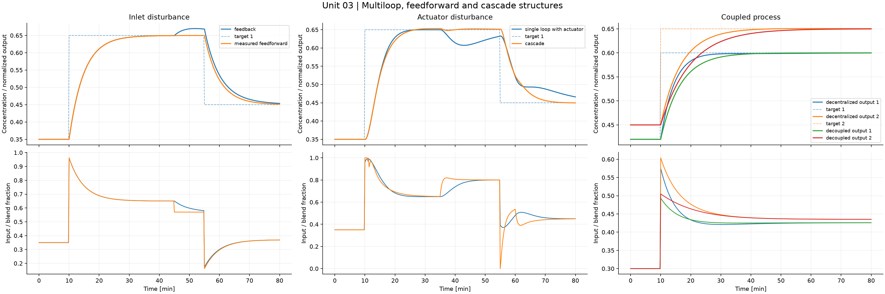

# 03. Multiloop, feedforward and cascade structures

[](https://colab.research.google.com/github/fobos123deimos/Undergraduate-Course-Intelligent-Systems-for-Process-Control-and-Automation/blob/main/laboratories/03-control-structures/notebook.ipynb)

A measured inlet disturbance can be canceled nominally by $u=v-d$.
A cascade loop measures the fast actuator variable and closes an inner loop
before the slower concentration controller. Multivariable interactions are
summarized by $\Lambda=K\circ(K^{-1})^T$; a static decoupler $K^{-1}$
cancels steady interaction, not all transient dynamics. Compare only cases
with the same disturbance location and measurement information.

```bash
python tools/run_course.py --unit 3
```

[Notebook](notebook.ipynb) · [Metrics](results/metrics.json) · [Course notes](../../course/README.md) · [Problems and solutions](../../problem-sets/README.md)


