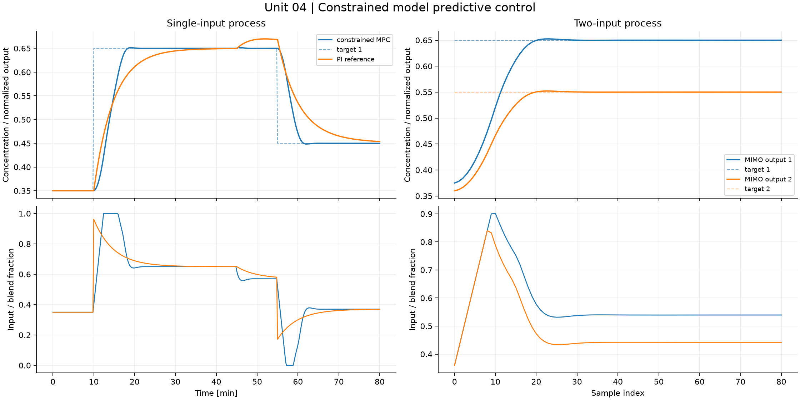
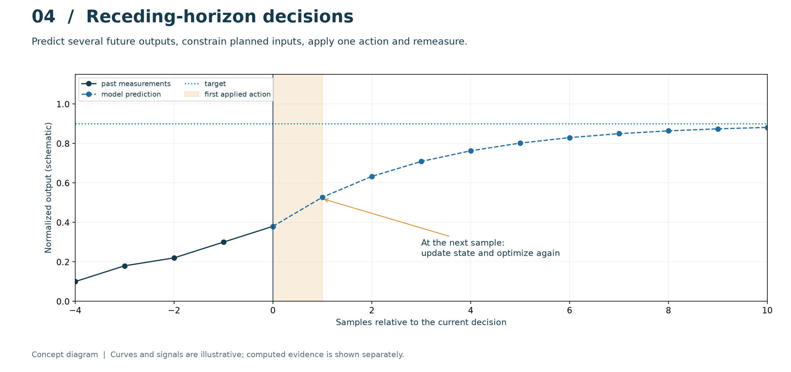
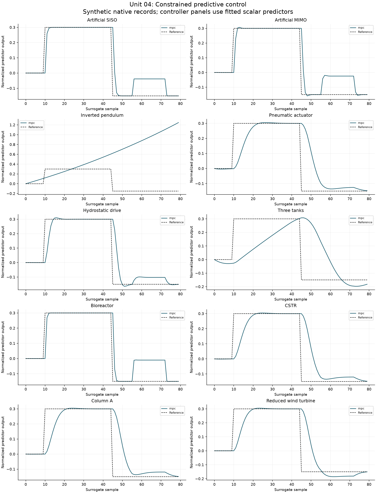

# 04. Constrained model predictive control

[](https://colab.research.google.com/github/fobos123deimos/Undergraduate-Course-Intelligent-Systems-for-Process-Control-and-Automation/blob/main/laboratories/04-model-predictive-control/notebook.ipynb)

At each sample solve

$$
\min_U\sum_{j=1}^{N_p}\lVert\hat x_{k+j}-r\rVert_Q^2+
\sum_{j=0}^{N_c-1}\lVert\Delta u_{k+j}\rVert_R^2.
$$

subject to $\hat x^+=A\hat x+B u$, actuator bounds and move bounds.
Only the first optimized action is applied. Beyond the control horizon, hold
the final move. Inspect solver failures as well as tracking error.
The second experiment uses two coupled states and two constrained inputs.

```bash
python tools/run_course.py --unit 4
```

[Notebook](notebook.ipynb) · [Metrics](results/metrics.json) · [Course notes](../../course/README.md) · [Problems and solutions](../../problem-sets/README.md)



## Read the method visually



Solid points are past observations and dashed points are predictions. The shaded interval marks the only action applied before remeasurement. The curve is a conceptual sketch, not the optimizer output. In the computed result, inspect input and move limits, horizon choices and solver success alongside SISO tracking and the two MIMO outputs.

The conceptual diagram is deliberately separate from the computed experiment below. [Editable SVG](../../course/figures/learning/unit-04.svg).

## Apply this unit to the article benchmarks

[Worked benchmark study for Unit 04](../../benchmarks/learning/unit-04.md)



Read the per-model method, chosen signals, numerical results and interpretation in the linked study. The learning track declares its local-model approximations and separates equation-based experiments from external datasets and simulators. It does not turn an unavailable measured record into a synthetic benchmark result.
