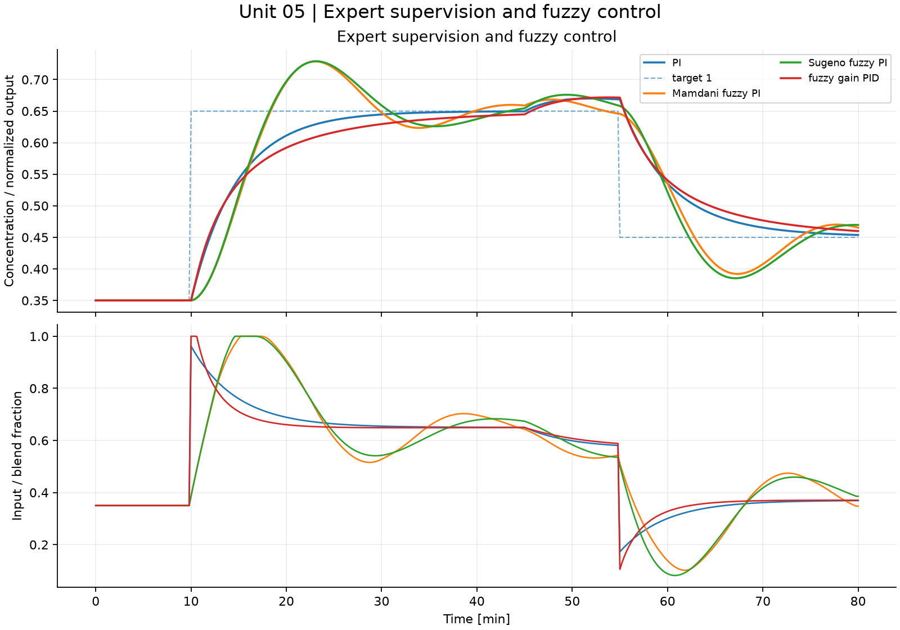
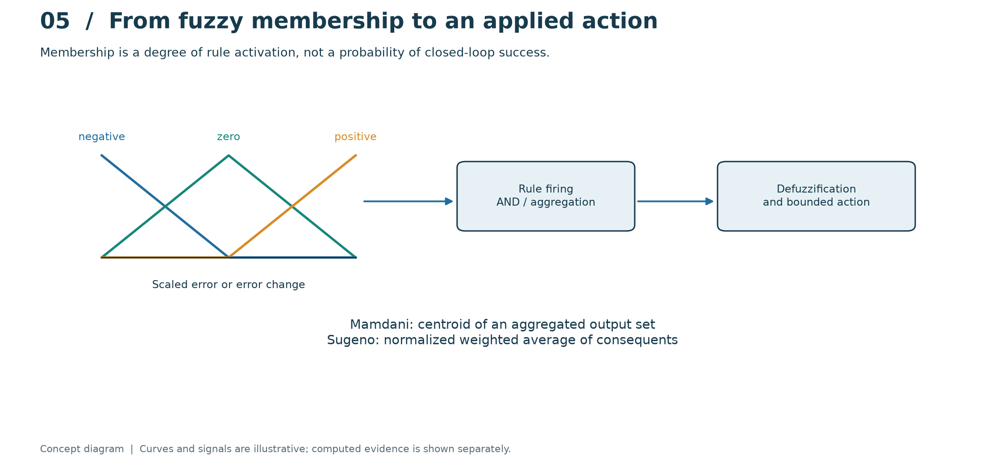
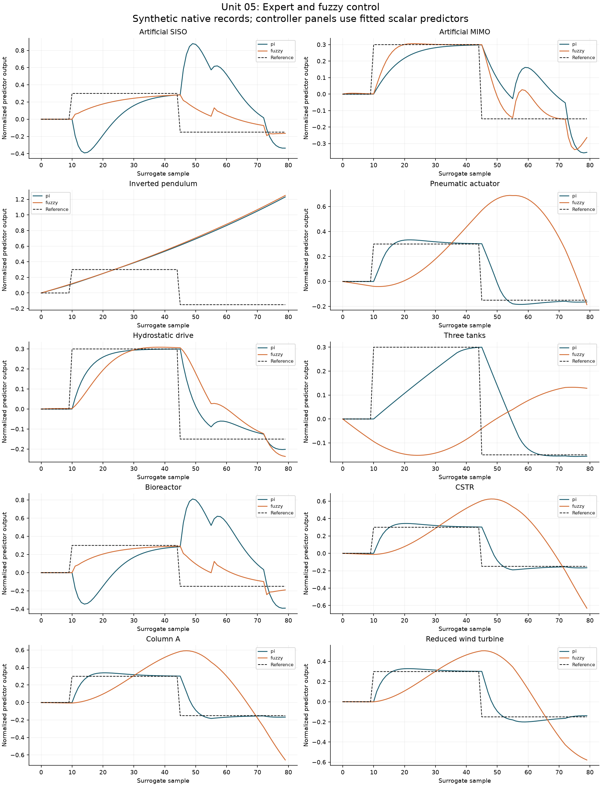

# 05. Expert supervision and fuzzy control

[](https://colab.research.google.com/github/fobos123deimos/Undergraduate-Course-Intelligent-Systems-for-Process-Control-and-Automation/blob/main/laboratories/05-expert-fuzzy-control/notebook.ipynb)

Crisp supervisory rules produce traceable diagnoses. Fuzzy inference
instead represents graded membership. Mamdani uses min firing, max aggregation
and centroid defuzzification; Sugeno uses a normalized weighted average of
singleton consequents. The nine rules here form a PD-like surface used in an
incremental PI law. A separate example schedules PID gains. None of these
finite scenarios establishes global closed-loop stability.

```bash
python tools/run_course.py --unit 5
```

[Notebook](notebook.ipynb) · [Metrics](results/metrics.json) · [Course notes](../../course/README.md) · [Problems and solutions](../../problem-sets/README.md)



## Read the method visually



The triangles show overlapping negative, zero and positive membership sets. Rule firing combines error and error-change memberships before producing an incremental action. The two inference methods differ in aggregation and defuzzification. Compare the recorded tracking and actuator curves; membership values are not calibrated probabilities or stability guarantees.

The conceptual diagram is deliberately separate from the computed experiment below. [Editable SVG](../../course/figures/learning/unit-05.svg).

## Apply this unit to the article benchmarks

[Worked benchmark study for Unit 05](../../benchmarks/learning/unit-05.md)



Read the per-model method, chosen signals, numerical results and interpretation in the linked study. The learning track declares its local-model approximations and separates equation-based experiments from external datasets and simulators. It does not turn an unavailable measured record into a synthetic benchmark result.
