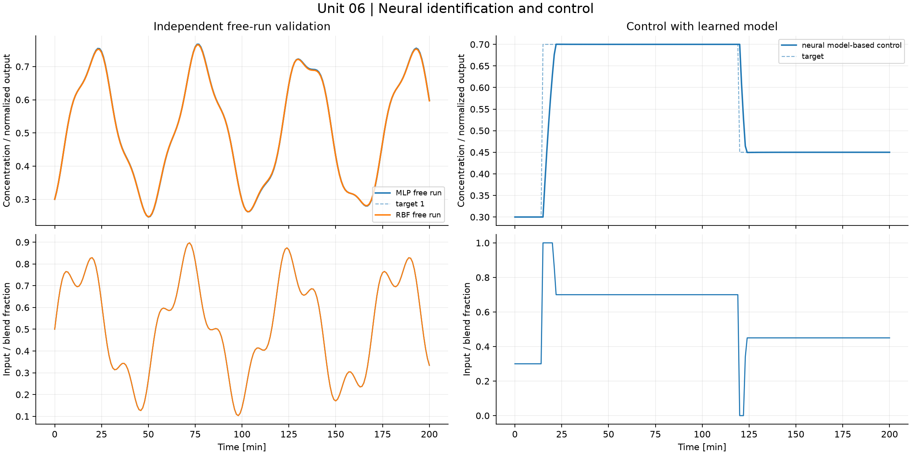
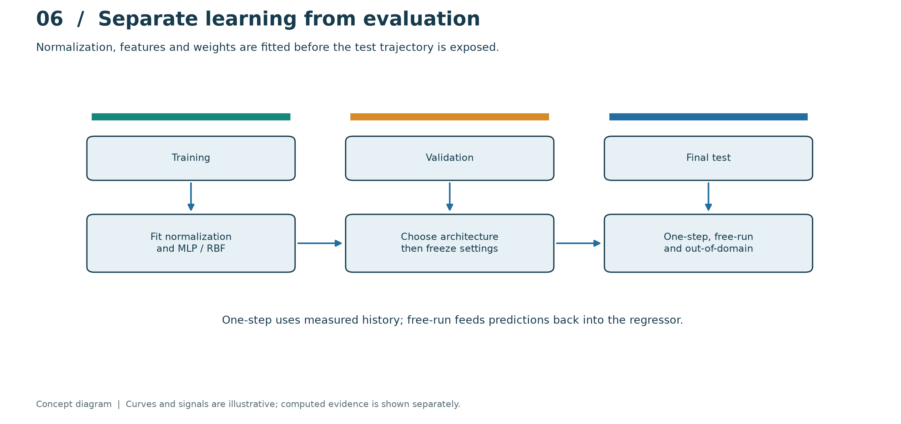
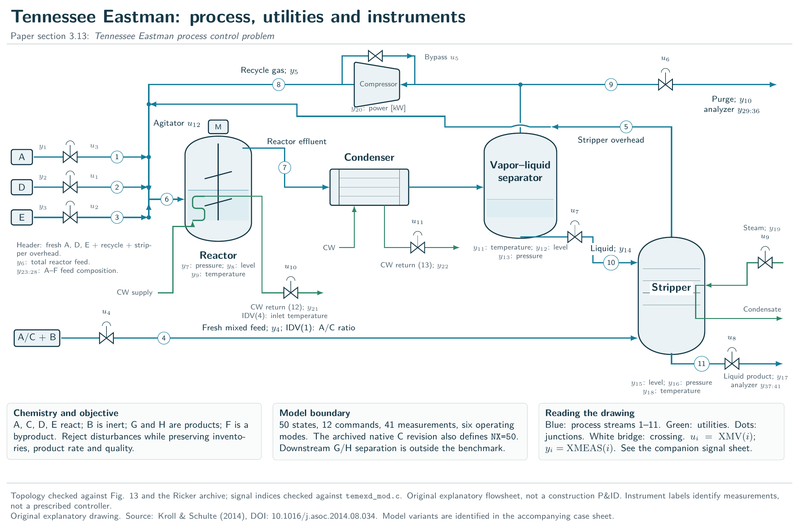
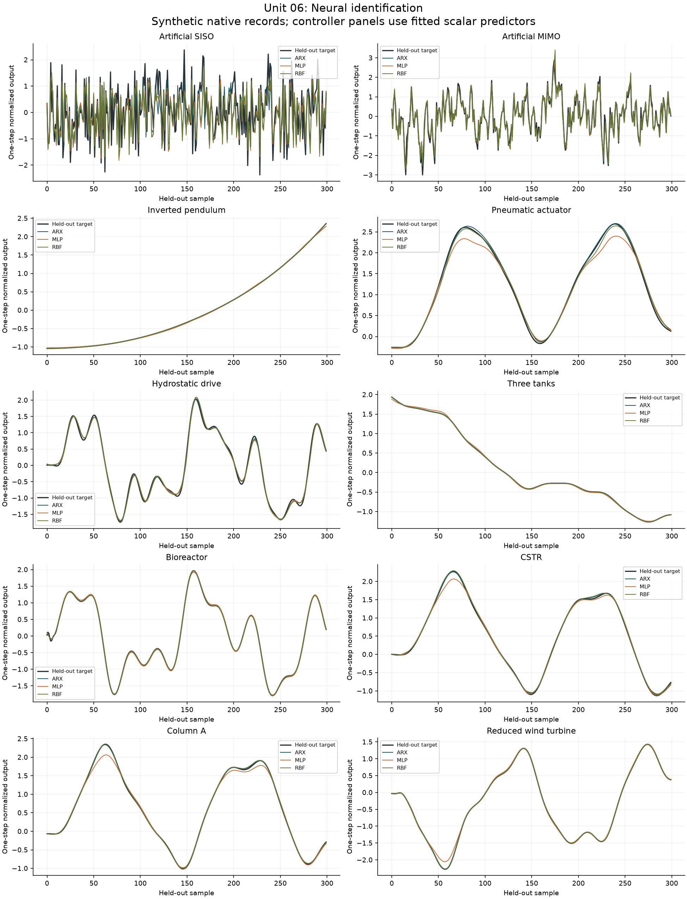

# 06. Neural identification and control

[](https://colab.research.google.com/github/fobos123deimos/Undergraduate-Course-Intelligent-Systems-for-Process-Control-and-Automation/blob/main/laboratories/06-neural-identification-control/notebook.ipynb)

The illustrative nonlinear transition is
$c^+=u+(c-u)\exp[-T_s(1+0.6c)/10]$. It freezes the flushing coefficient
over a sample and is explicitly different from the article benchmarks.
Fit a tanh MLP and a Gaussian RBF network with normalization learned on
training inputs only. Validate untouched transitions, a recursive trajectory
and out-of-domain points separately. The controller evaluates bounded actions
through the trained MLP. Perceptron classification and SOM clustering use the
same input domain to illustrate distinct learning objectives.

```bash
python tools/run_course.py --unit 6
```

[Notebook](notebook.ipynb) · [Metrics](results/metrics.json) · [Course notes](../../course/README.md) · [Problems and solutions](../../problem-sets/README.md)



## Read the method visually



Chronology separates fitting, selection and final scoring. Fit normalization on the training set and freeze it before evaluating the others. A one-step predictor sees measured history; the recursive path sees its own past predictions. Read these scores separately, and use the out-of-domain experiment to expose unsupported extrapolation.

The conceptual diagram is deliberately separate from the computed experiment below. [Editable SVG](../../course/figures/learning/unit-06.svg).

## Apply this unit to the article benchmarks

[Original article names and detailed TikZ atlas](../../benchmarks/DIAGRAMS.md) · [Download the vector atlas](../../benchmarks/figures/tikz/benchmark-atlas.pdf)



The atlas identifies every benchmark by its original paper name and repository alias, with equipment, states and signals. The Tennessee Eastman companion plate maps the 12 commands and 41 measurements.

[Worked benchmark study for Unit 06](../../benchmarks/learning/unit-06.md)



Read the per-model method, chosen signals, numerical results and interpretation in the linked study. The learning track declares its local-model approximations and separates equation-based experiments from external datasets and simulators. It does not turn an unavailable measured record into a synthetic benchmark result.
