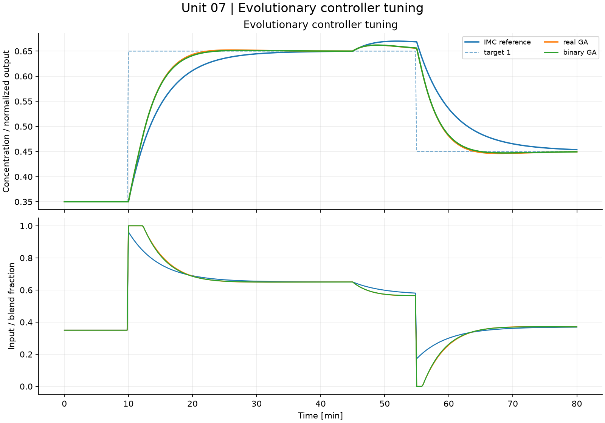
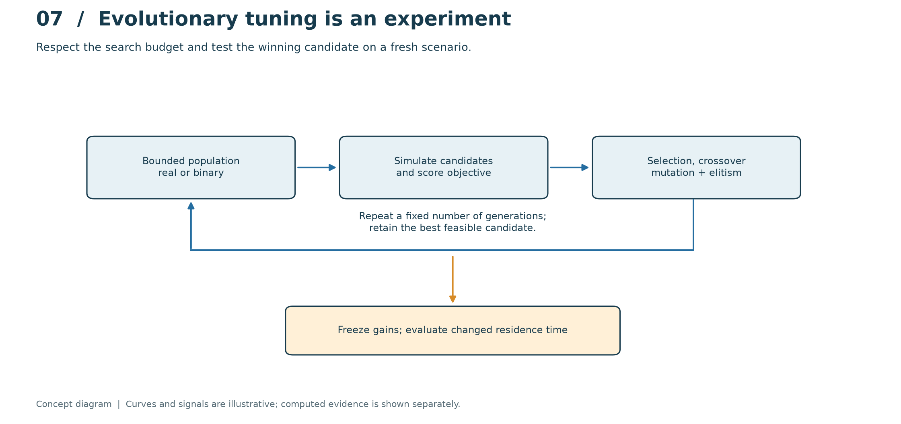
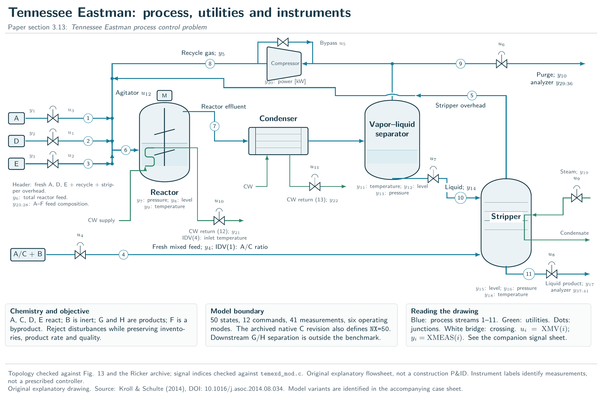
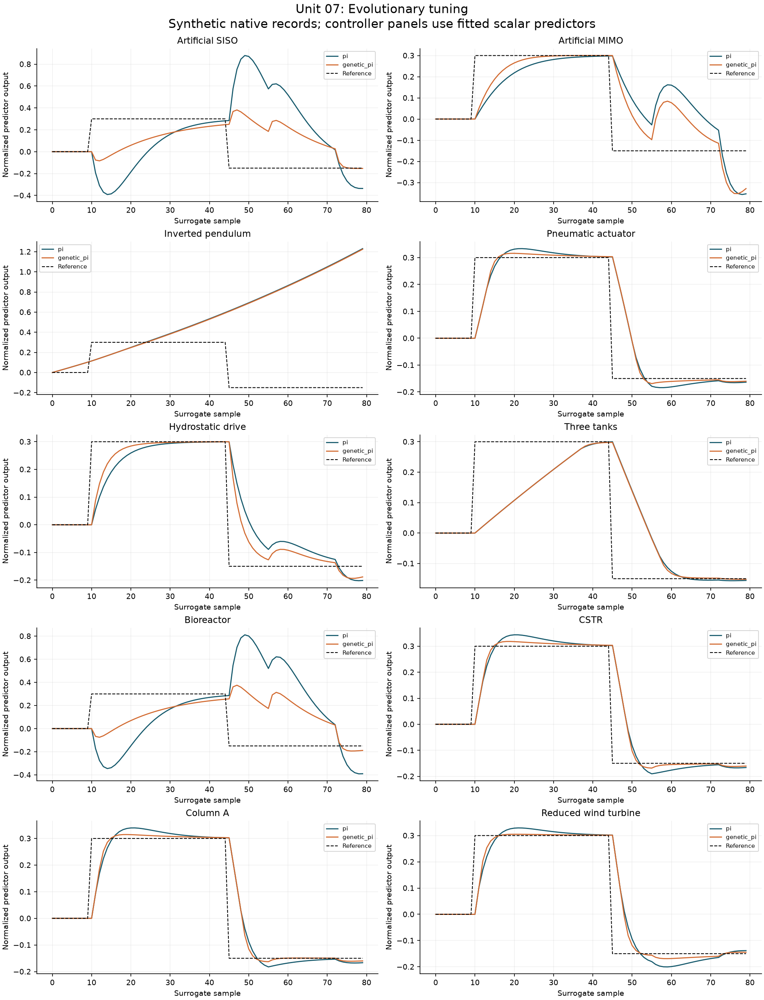

# 07. Evolutionary controller tuning

[](https://colab.research.google.com/github/fobos123deimos/Undergraduate-Course-Intelligent-Systems-for-Process-Control-and-Automation/blob/main/laboratories/07-evolutionary-tuning/notebook.ipynb)

Encode $(K_p,K_i)$ as bounded real values or 12-bit binary chromosomes.
Use tournament selection, crossover, mutation and elitism to minimize
$J=\mathrm{IAE}+0.03\sum_k|u_k-u_{k-1}|$. Equal population and generation
counts give equal numbers of objective evaluations, not equal wall-clock cost.
Report the seeded search and test its gains on a changed residence time.
A small outer search also tunes a MIMO MPC move penalty; it is not a claim
of a global optimum.

```bash
python tools/run_course.py --unit 7
```

[Notebook](notebook.ipynb) · [Metrics](results/metrics.json) · [Course notes](../../course/README.md) · [Problems and solutions](../../problem-sets/README.md)



## Read the method visually



Each candidate is evaluated by a closed-loop simulation before selection and variation. Elitism retains the best candidate under the declared objective, and the loop stops at a fixed evaluation budget. The final test changes residence time after gains have been frozen. Read both convergence history and held-out closed-loop behavior; the best sampled candidate is not a proven global optimum.

The conceptual diagram is deliberately separate from the computed experiment below. [Editable SVG](../../course/figures/learning/unit-07.svg).

## Apply this unit to the article benchmarks

[Original article names and detailed TikZ atlas](../../benchmarks/DIAGRAMS.md) · [Download the vector atlas](../../benchmarks/figures/tikz/benchmark-atlas.pdf)



The atlas identifies every benchmark by its original paper name and repository alias, with equipment, states and signals. The Tennessee Eastman companion plate maps the 12 commands and 41 measurements.

[Worked benchmark study for Unit 07](../../benchmarks/learning/unit-07.md)



Read the per-model method, chosen signals, numerical results and interpretation in the linked study. The learning track declares its local-model approximations and separates equation-based experiments from external datasets and simulators. It does not turn an unavailable measured record into a synthetic benchmark result.
