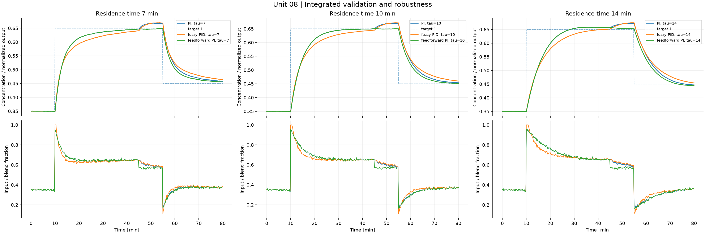
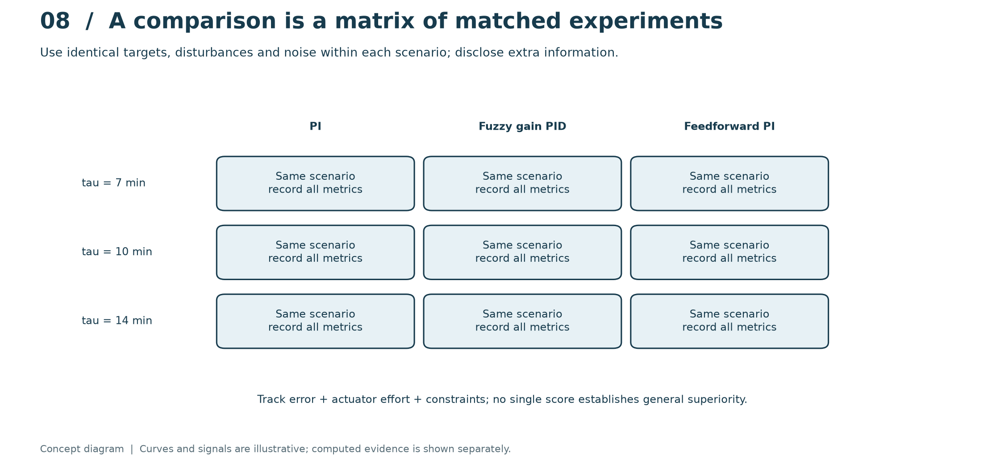
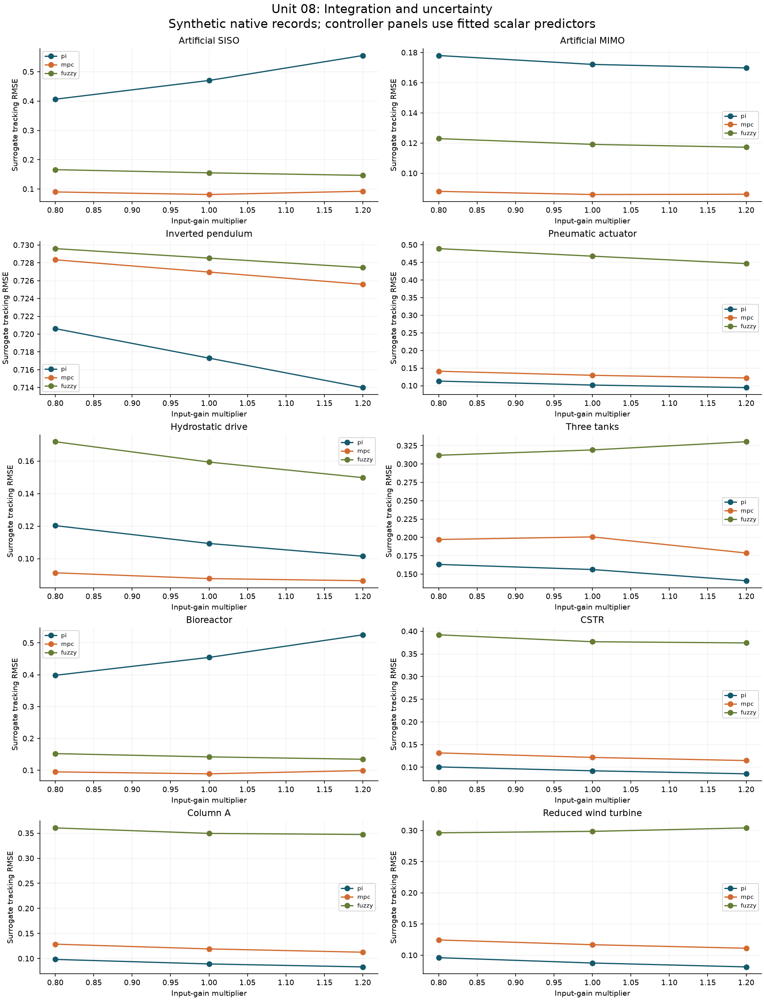

# 08. Integrated validation and robustness

[](https://colab.research.google.com/github/fobos123deimos/Undergraduate-Course-Intelligent-Systems-for-Process-Control-and-Automation/blob/main/laboratories/08-integrated-validation/notebook.ipynb)

Compare PI, fuzzy gain PID and feedforward PI at residence times 7,
10 and 14 min, using the same sensor-noise seed and reference/disturbance
schedule. Report IAE, ISE, ITAE, actuator energy, movement and violations.
Feedforward receives a disturbance measurement, so its information advantage
must be stated. These are synthetic matched scenarios, not measured evidence
or statistical confidence bounds. A final recommendation must state which
constraint or uncertainty determines the preferred controller.

```bash
python tools/run_course.py --unit 8
```

[Notebook](notebook.ipynb) · [Metrics](results/metrics.json) · [Course notes](../../course/README.md) · [Problems and solutions](../../problem-sets/README.md)



## Read the method visually



Rows change the process residence time, while columns change the controller. Within a row, target, disturbance and noise are matched. Evaluate error, effort, movement and constraint violations together. Feedforward receives an extra disturbance measurement; describe that advantage when interpreting the comparison.

The conceptual diagram is deliberately separate from the computed experiment below. [Editable SVG](../../course/figures/learning/unit-08.svg).

## Apply this unit to the article benchmarks

[Worked benchmark study for Unit 08](../../benchmarks/learning/unit-08.md)



Read the per-model method, chosen signals, numerical results and interpretation in the linked study. The learning track declares its local-model approximations and separates equation-based experiments from external datasets and simulators. It does not turn an unavailable measured record into a synthetic benchmark result.
