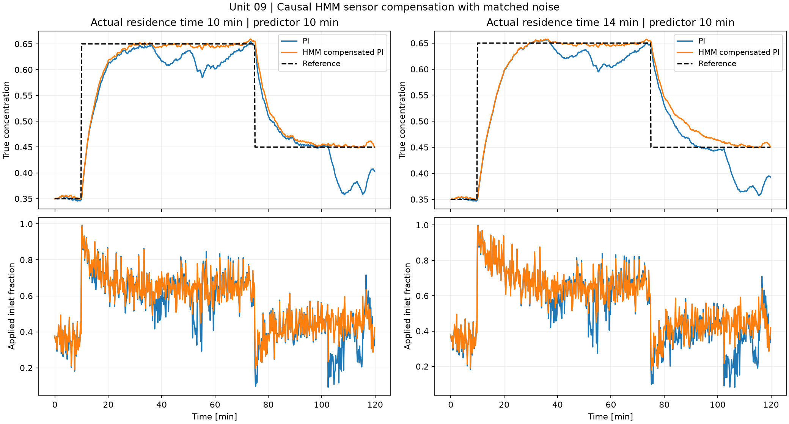
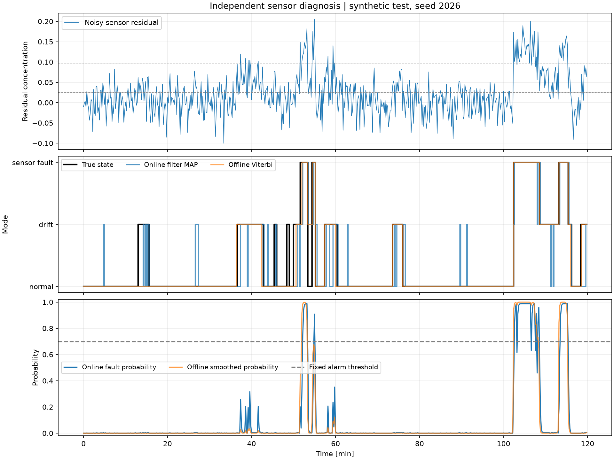

# 09. Markov chains and hidden-state diagnosis

[](https://colab.research.google.com/github/fobos123deimos/Undergraduate-Course-Intelligent-Systems-for-Process-Control-and-Automation/blob/main/laboratories/09-markov-hidden-state-diagnosis/notebook.ipynb)

A Markov chain describes transitions among normal, drifting and faulty sensor
modes. A categorical hidden Markov model infers these modes from noisy tank
residuals. Compute multi-step probabilities, stationary distributions and first
fault times; compare causal filtering with offline smoothing and Viterbi decoding.
Fit parameters using independent calibration sequences, then evaluate a held-out
trajectory. Baum-Welch illustrates unsupervised learning and label ambiguity.
Finally, use only the causal posterior to compensate a sensor in a PI loop,
and repeat with process-model mismatch. This unit is an enrichment beyond the
eight supplied syllabus units and the article benchmark inventory.

```bash
python tools/run_course.py --unit 9
```

[Notebook](notebook.ipynb) · [Metrics](results/metrics.json) · [Course notes](../../course/README.md) · [Problems and solutions](../../problem-sets/README.md)





[Detailed lesson](../../course/09-markov-hidden-state-diagnosis/lesson.md) · [Exercises](../../problem-sets/09-markov-hidden-state-diagnosis/exercises.md) · [Worked solutions](../../problem-sets/09-markov-hidden-state-diagnosis/solutions.md)

The notebook separates chains, a hand-checkable HMM, supervised calibration, Baum-Welch, held-out diagnosis and causal PI supervision. CSV traces include true states for retrospective scoring only. Offline estimates never enter the controller.
