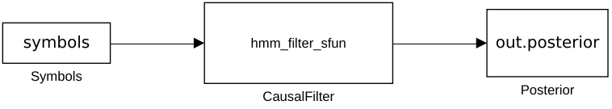

# Validated Simulink model gallery

These **25 SLX models and 25 PNG views** were generated and executed in MATLAB R2025b Update 7 with Simulink. They are preserved unchanged from [successful run 41886384567](https://github.com/fobos123deimos/Undergraduate-Course-Intelligent-Systems-for-Process-Control-and-Automation/actions/runs/41886384567). The [validation report](validation.json) records numerical comparisons and the [provenance manifest](provenance.json) records source, artifact and file hashes.

## Open an existing model

Keep the complete repository and run from its root in MATLAB with Simulink:

```matlab
addpath('matlab'); addpath('simulink');
open_system(fullfile('simulink','models','markov','si_hmm_diagnosis.slx'));
output = sim('si_hmm_diagnosis');
```

Inputs and parameters are embedded in each model workspace. The S-functions and numerical helpers are supplied in the repository; these SLX files are not standalone replacements for those sources. No Control System Toolbox is required. Saved-model compatibility with older MATLAB releases has not been established. To rebuild and revalidate, use the [source guide](../README.md) with a new output folder.

The gallery counts distinct diagrams, including variants, rather than distinct physical plant families. The [coverage review](../../docs/COVERAGE_REVIEW.md) separates ten article equation cores, external industrial simulators and full benchmark protocols. The JSON report retains the originating runner's diagnostic paths as execution provenance, not required model locations.

| Group | Model | Open | Preview |
|---|---|---|---|
| blending | bt comparison corrected | [SLX](blending/bt_comparison_corrected.slx) | [PNG](blending/bt_comparison_corrected.png) |
| blending | bt nonlinear corrected | [SLX](blending/bt_nonlinear_corrected.slx) | [PNG](blending/bt_nonlinear_corrected.png) |
| discrete | bioreactor sample | [SLX](discrete/si_paper_bioreactor_sample.slx) | [PNG](discrete/si_paper_bioreactor_sample.png) |
| discrete | mimo | [SLX](discrete/si_paper_mimo.slx) | [PNG](discrete/si_paper_mimo.png) |
| discrete | siso | [SLX](discrete/si_paper_siso.slx) | [PNG](discrete/si_paper_siso.png) |
| general | blend physical | [SLX](general/si_blend_physical.slx) | [PNG](general/si_blend_physical.png) |
| general | mimo mpc | [SLX](general/si_mimo_mpc.slx) | [PNG](general/si_mimo_mpc.png) |
| general | bioreactor | [SLX](general/si_paper_bioreactor.slx) | [PNG](general/si_paper_bioreactor.png) |
| general | column a | [SLX](general/si_paper_column_a.slx) | [PNG](general/si_paper_column_a.png) |
| general | cstr | [SLX](general/si_paper_cstr.slx) | [PNG](general/si_paper_cstr.png) |
| general | hydrostatic | [SLX](general/si_paper_hydrostatic.slx) | [PNG](general/si_paper_hydrostatic.png) |
| general | pendulum | [SLX](general/si_paper_pendulum.slx) | [PNG](general/si_paper_pendulum.png) |
| general | pneumatic | [SLX](general/si_paper_pneumatic.slx) | [PNG](general/si_paper_pneumatic.png) |
| general | three tank | [SLX](general/si_paper_three_tank.slx) | [PNG](general/si_paper_three_tank.png) |
| general | wind | [SLX](general/si_paper_wind.slx) | [PNG](general/si_paper_wind.png) |
| general | tank pi | [SLX](general/si_tank_pi.slx) | [PNG](general/si_tank_pi.png) |
| intelligent | fuzzy pid tank | [SLX](intelligent/si_fuzzy_pid_tank.slx) | [PNG](intelligent/si_fuzzy_pid_tank.png) |
| intelligent | neural rbf tank | [SLX](intelligent/si_neural_rbf_tank.slx) | [PNG](intelligent/si_neural_rbf_tank.png) |
| markov | hmm diagnosis | [SLX](markov/si_hmm_diagnosis.slx) | [PNG](markov/si_hmm_diagnosis.png) |
| markov | hmm mismatch baseline | [SLX](markov/si_hmm_mismatch_baseline.slx) | [PNG](markov/si_hmm_mismatch_baseline.png) |
| markov | hmm mismatch supervisor | [SLX](markov/si_hmm_mismatch_supervisor.slx) | [PNG](markov/si_hmm_mismatch_supervisor.png) |
| markov | hmm nominal baseline | [SLX](markov/si_hmm_nominal_baseline.slx) | [PNG](markov/si_hmm_nominal_baseline.png) |
| markov | hmm nominal supervisor | [SLX](markov/si_hmm_nominal_supervisor.slx) | [PNG](markov/si_hmm_nominal_supervisor.png) |
| markov | markov occupancy | [SLX](markov/si_markov_occupancy.slx) | [PNG](markov/si_markov_occupancy.png) |
| wind-control | wind pdc | [SLX](wind-control/si_wind_pdc.slx) | [PNG](wind-control/si_wind_pdc.png) |

## Example: causal hidden-state diagnosis


